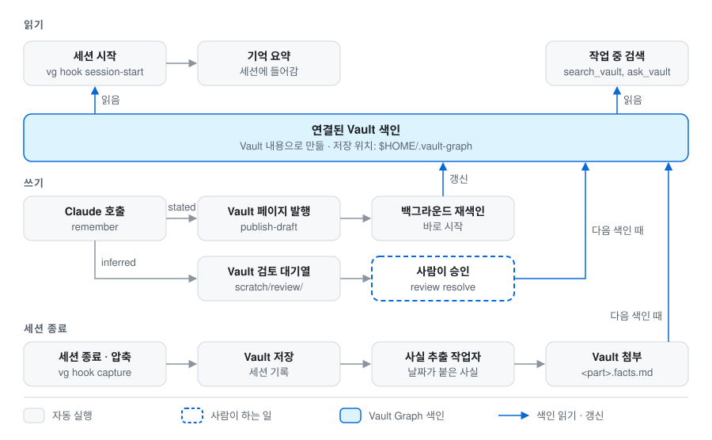

# Vault Graph

[English](README.md) | 한국어

상태: 정식 출시 전 개발 단계

Vault Graph는 Claude Code에 오래 가는 기억을 붙여 주는 도구이며, 명령 이름은 `vg` 입니다. 기억은
vault-builder가 관리하는 Vault에 저장됩니다. Vault Graph는 이 Vault들을 색인해 두고,
세션을 시작할 때마다 필요한 기억을 Claude에게 알려 주며, 작업 중에는 Claude가 기억을
찾고 저장할 수 있게 합니다. Vault 파일을 직접 고치는 일은 없습니다. 모든 변경은 Vault에
들어 있는 도구를 거칩니다.

## 자동으로 일어나는 일

설치한 뒤에는 아래 일을 직접 실행할 필요가 없습니다. 원하면 각 단계를 손으로 실행할
수도 있으며, 그 방법을 단계마다 적었습니다.

<picture>
  <source media="(prefers-color-scheme: dark)" srcset="docs/assets/vault-graph-flow-ko-dark.svg">
  
</picture>

1. **세션을 시작하면** Vault Graph가 바뀐 Vault 파일을 먼저 반영하고, 이 프로젝트 기억의
   짧은 요약을 Claude에게 줍니다. 고정(pin)한 기억이 맨 앞에 옵니다. 새 파일의 임베딩은
   그 뒤에 백그라운드에서 만들어집니다.
   - 직접 실행: `echo '{}' | vg hook session-start`, 또는 MCP 도구
     `summarize_project_memory`
2. **세션이 끝나거나 Claude가 대화를 압축하면** Vault Graph가 대화를 Vault에 넘기고,
   Vault가 저장합니다.
   - 직접 실행: `vg session export --agent claude-code --out /path/outside/vaults --session ID --recapture`
3. **세션이 저장되면** 백그라운드 작업자가 Claude(또는 직접 고른 로컬 모델)에게 대화에서
   날짜가 붙은 짧은 사실을 뽑게 합니다. Vault는 이 사실을 저장된 세션 옆에 첨부하고,
   검색은 이 사실을 단서로 대화의 해당 부분을 찾습니다. 기본으로 켜져 있으며
   `vg facts off` 명령으로 끌 수 있습니다.
   - 직접 실행: 대기열 확인은 `vg facts status`, 처리는 `vg facts worker`
   - 선택 기능: `vg dream on`을 켜면 백그라운드 작업자가 저장된 세션에서 기억할 만한 것을
     골라 제안합니다. `vg review` 명령으로 승인하기 전에는 아무것도 저장되지 않습니다.
     보낸 제안은 `vg dream status`로 봅니다.
4. **사용자가 말한 사실을 Claude가 기억으로 저장하면** Vault Graph가 그 Vault를
   백그라운드에서 다시 색인합니다. 그래서 새 페이지가 검색과 다음 세션 요약에 나옵니다.
   - 직접 실행: `vg index --vault-id ID` 또는 `vg index --all-vaults`
5. **Claude가 스스로 추론한 기억은** 바로 저장되지 않습니다. 사람이 승인할 때까지 Vault
   검토 대기열에서 기다리며, 그동안 검색과 세션 요약에 나오지 않습니다.
   - 직접 실행: 프로젝트 폴더에서 `vg review`를 실행합니다. 대기 중인 제안을 하나씩
     보여주며, 어떤 글이 바뀌는지와 근거를 확인한 뒤 승인, 거절, 건너뛰기 중에서 고릅니다.
     승인한 기억은 백그라운드에서 색인됩니다. 목록만 보려면 `vg review list`를 씁니다.

그 밖의 일은 Claude가 MCP 도구로 합니다. 찾을 때는 `search_vault`, `ask_vault` 도구를,
저장할 때는 `remember`, `update_memory` 도구를 씁니다. 모든 기능과 도구, 각 기능이 읽고
쓰는 파일은 [docs/FEATURES.md](docs/FEATURES.md) 문서에 있습니다.

## 설치

Claude Code를 끈 뒤 터미널에서 아래 명령을 실행하세요. `vg` 명령과 vault-builder를
설치하고, Vault와 훅을 설정하고, MCP 서버를 등록합니다.

```bash
curl -fsSL https://raw.githubusercontent.com/cutehackers/vault-graph/main/scripts/install.sh | bash
```

Claude Code를 다시 켜고 `/mcp` 화면에서 서버를 확인하세요. 그다음 Vault를 한 번
색인합니다. 처음에는 시간이 걸릴 수 있습니다.

```bash
vg index --all-vaults
```

다른 태그나 브랜치를 설치하려면 `VAULT_GRAPH_REF` 환경 변수를 정하세요. 지우려면
`--uninstall` 옵션을 붙입니다(`| bash -s -- --uninstall`). `vg` 명령만 설치하려면:

```bash
uv tool install --python 3.12 git+https://github.com/cutehackers/vault-graph.git@vX.Y.Z
```

모든 옵션, Codex 설정, MCP 등록 방법은 [docs/INSTALL.md](docs/INSTALL.md) 문서를
보세요(영어).

## 빠른 시작

설치 명령이 setup 단계까지 이미 실행합니다. `vg` 명령만 따로 설치했을 때만 직접
실행하세요.

```bash
vg setup --agent claude --mcp --dry-run
vg setup --agent claude --mcp
```

Codex에서는 `vg setup --vault /path/to/vault --agent codex --mcp` 명령을 씁니다. 처음
색인할 때 로컬 임베딩 모델을 내려받을 수 있습니다. 그다음 써 보세요.

```bash
vg ask --graph-home ~/.vault-graph "What changed recently?"
vg search --graph-home ~/.vault-graph "GraphRAG"
vg context --graph-home ~/.vault-graph "Implement GraphRAG MVP"
vg status --graph-home ~/.vault-graph
```

## 자주 쓰는 명령

| 하려는 일 | 명령 |
| --- | --- |
| 설정 문제 찾기 | `vg doctor` |
| 모든 Vault 색인 | `vg index --all-vaults` |
| 상태 확인 | `vg status` |
| 검색 | `vg search "query"` |
| 근거와 함께 묻기 | `vg ask "question"` |
| 사실 추출 상태 | `vg facts status` |
| 드리밍 상태 | `vg dream status` |
| 기억 제안 검토 | `vg review` |
| 임베딩 모델 보기 | `vg embedding list --graph-home ~/.vault-graph` |
| 모델이나 모델 폴더 바꾸기 | `vg embedding use arctic-m --models-dir /path/to/models --graph-home ~/.vault-graph` |

## 임베딩 모델

검색은 로컬 임베딩 모델을 씁니다. 기본 모델은 `arctic-m` 모델이며 크기는 약 311 MB입니다.
`e5-small` 모델은 더 작고 빠르지만, 한국어와 영어 페이지가 섞인 Vault에서는 순위가
덜 정확합니다. 모델 파일은 `~/llm/models` 폴더에 있습니다. `vg embedding list` 명령으로
목록을 보고 `vg embedding use` 명령으로 바꿉니다. 바꾼 뒤 다시 색인이 끝날 때까지는
키워드 검색 결과만 나옵니다. 모델 목록은 코드의 `EMBEDDING_PRESETS` 값에 있습니다.
시간, 메모리, 업그레이드 절차는 [docs/INSTALL.md](docs/INSTALL.md#embedding-model)
문서를 보세요(영어).

## 소스에서 개발하기

```bash
git clone https://github.com/cutehackers/vault-graph.git
cd vault-graph
uv sync
uv tool install --python 3.12 -e .
```

재사용 패키지, 빌드, 그래프 백엔드는 [docs/DEVELOPMENT.md](docs/DEVELOPMENT.md)
문서를 보세요(영어).

## 더 읽을 문서

아래 문서는 영어로만 있습니다.

- [docs/INSTALL.md](docs/INSTALL.md): 설치 옵션, setup, MCP 등록, 임베딩 모델
- [docs/FEATURES.md](docs/FEATURES.md): 모든 기능, 명령, MCP 도구, 리소스, 프롬프트
- [docs/DEVELOPMENT.md](docs/DEVELOPMENT.md): 소스 작업과 재사용 패키지
- [CHANGELOG.md](CHANGELOG.md): 릴리스별 변경 내용
- [docs/ARCHITECTURE.md](docs/ARCHITECTURE.md): 소스 구조와 조립 방식
- [docs/DECISIONS.md](docs/DECISIONS.md): 확정된 설계 결정
- [docs/PUBLISHING.md](docs/PUBLISHING.md): 릴리스 절차

## 라이선스

MIT 라이선스입니다. [`LICENSE`](LICENSE) 파일을 보세요.
