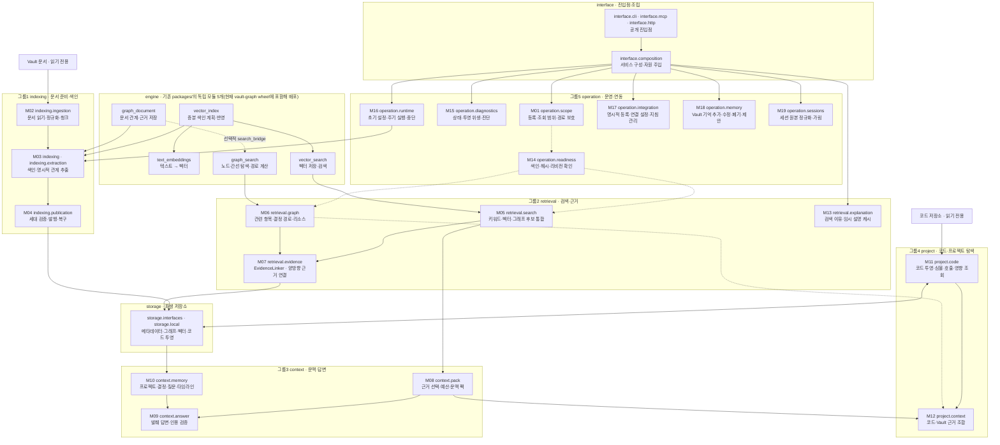

# 현재 구현 아키텍처

이 문서는 현재 소스의 위치·책임·의존 규칙을 정한다. [SPEC.md](SPEC.md)는 활성 제품 계약이며 불변성 엔진과 조정 저장소의 향후 구현도 포함한다. 이 문서의 `engine`은 이미 구현된 일반 패키지 5개의 논리적 분류이다. `vault_graph.invariants`나 새 `engine/` 디렉터리의 구현을 뜻하지 않는다.

## 1. 소스 구조와 소유권

아래 경로는 `src/vault_graph/` 기준이다. 그룹은 실제 디렉터리이며 배포 단위는 아니다. M 번호는 [승인된 모듈 명세](design/specs/2026-10-15-vault-graph-modular-architecture-ko.md)의 책임을 유지한다.

```text
src/vault_graph/
├── indexing/                 # 색인 실행·계획·반영
│   ├── ingestion/           # 원본 읽기·정규화·청크
│   ├── extraction/          # 명시적 엔터티·관계 추출
│   ├── publication/         # Vault 투영 세대 발행
│   ├── index_service.py
│   ├── metadata_indexer.py
│   ├── vector_index_adapter.py # 실제 Vault 전용 벡터 색인 구현
│   ├── graph_indexer.py
│   └── revision_planner.py
├── retrieval/
│   ├── search/              # 후보 결합·순위·검색 응답
│   ├── graph/               # 그래프 계약·조회
│   │   └── projection/      # 일반 그래프 검색으로 변환·투영
│   ├── evidence/            # 검색 대상과 근거의 양방향 연결
│   └── explanation/         # 결과 이유·임시 설명 캐시
├── context/
│   ├── pack/                # 근거 선택·예산·문맥 팩
│   ├── memory/              # 파생 기억 조회
│   └── answer/              # 발췌 답변·인용 검증
├── project/
│   ├── code/                # 코드 투영·심볼·호출·영향 조회
│   └── context/             # 코드·Vault 근거 조합
├── operation/
│   ├── scope/               # 등록·범위·경로 보호
│   ├── readiness/           # 조회 전제 판정
│   ├── diagnostics/         # 상태·위생·진단 설명
│   ├── runtime/             # setup·watch·자원 종료
│   ├── memory/              # Vault 기억 쓰기(추가·수정·폐기·제안)
│   ├── sessions/            # 에이전트 세션 원본을 정규화 JSONL로 바꾸는 adapter·가림 규칙
│   └── integration/         # 명시적 연동 설정·지침 관리
│       ├── mcp/             # MCP 설정 파일 생성·등록
│       ├── harness/         # 지침 설치·제거
│       └── project_binding_catalog.py
├── interface/
│   ├── cli/
│   ├── mcp/
│   ├── http/
│   └── composition/         # 구체 구현 생성·주입·자원 수명
│       └── adapters/        # 제공자 구성·기존 생성자의 기본 구성
├── storage/
│   ├── interfaces/          # 저장소·임베딩 계약
│   └── local/               # SQLite·Chroma·문서 그래프 어댑터
└── errors.py
```

| 책임 | 구현 위치 | 소유 범위 |
|---|---|---|
| M01 범위·등록 | `operation/scope/` | catalog·Graph Home·안전 경로·조회 범위·Vault frontmatter 줄 규칙(`vault_frontmatter.py`, M02 색인과 M18 기억 쓰기가 함께 씀)·읽기 전용 git 실행(`git_command.py`, M11 코드 스캔과 M17 vault-map이 함께 씀) |
| M02 문서 준비 | `indexing/ingestion/` | 리더 선택·읽기·정규화·청크 |
| M03 투영 색인 | `indexing/`, `indexing/extraction/` | 문서 선택·색인 계획·반영·명시적 관계 추출·바뀐 파일 찾기(`change_scan.py`)·바뀐 파일만 반영할 때 사라진 청크의 벡터 지우기(`IndexService.run_apply_paths`). 세션 시작 갱신(`interface/composition/recall_index_refresh.py`)은 저장소를 열어 주기만 하고 직접 읽거나 지우지 않는다 |
| M04 세대 발행 | `indexing/publication/` | 비공개 세대 검증·활성화·폐기·복구 |
| M05 통합 검색 | `retrieval/search/` | 키워드·벡터·선택적 그래프 후보 결합·순위·주변 청크 |
| M06 그래프 조회 | `retrieval/graph/` | 관련 항목·결정 경로·리소스·일반 그래프 투영 어댑터 |
| M07 근거 연결 | `retrieval/evidence/` | 대상→문서/청크 및 근거→그래프 소유자. 저장소 계약은 `storage/interfaces/evidence_owner_lookup.py` |
| M08 문맥 팩 | `context/pack/` | 근거 선택·예산·누락 설명·팩 구성 |
| M09 발췌 답변 | `context/answer/` | 근거 수집·발췌·인용 검증·렌더링 |
| M10 기억 조회 | `context/memory/` | 프로젝트·결정·질문·타임라인의 파생 조회 |
| M11 코드 투영·조회 | `project/code/` | 스캔·파싱·참조 해석·코드 전용 세대·심볼/호출/영향 |
| M12 프로젝트 문맥 | `project/context/` | 명시적 저장소↔Vault 연결의 코드·문서 근거 조합 |
| M13 결과 설명 | `retrieval/explanation/` | 검색 이유와 최대 256건의 프로세스 임시 캐시 |
| M14 준비 상태 | `operation/readiness/` | 색인·근거 해시·리비전의 조회 전제 판정 |
| M15 진단 | `operation/diagnostics/` | 상태·투영 위생·확장 준비 설명. 자동 수리하지 않음 |
| M16 실행 운영 | `operation/runtime/` | 초기 설정·주기 색인·중단·자원 정리 |
| M17 연동 설정 | `operation/integration/` | MCP 등록·저장소 연결 catalog·지침의 명시적 변경 |
| M18 기억 쓰기 | `operation/memory/` | 저장 Vault 고르기·draft 만들기·Vault 쓰기 포트·Vault별 잠금. Vault 명령 실행과 draft 파일 쓰기(`DraftFiles` 포트)는 `interface/composition/adapters/`가 한다(§4). M18 자체는 파일을 쓰지 않는다 |
| M19 세션 정규화 | `operation/sessions/` | 에이전트 원본 세션 레코드를 `vg-session-jsonl/1` 줄로 바꾸는 순수 코드(`claude_code_adapter.py`, `normalized_jsonl.py`, 가림 규칙 `redact.py`, 레코드 모델 `models.py`). 파일 읽기·쓰기와 실행기 호출은 `interface/composition/adapters/`가 한다. 형식은 [vg-session-jsonl/1 계약](contracts/vg-session-jsonl-v1.md) |

2026-11-05 [세션·색인·기억 관리 spec](specs/2026-11-05-session-memory-indexing/spec.md)이 더한 파일의 위치는 다음과 같다.

| 영역 | 파일 | 하는 일 |
|---|---|---|
| M01 | `operation/scope/session_export_settings.py` | Graph Home `configs/session-export.json` 형식 확인과 읽기·쓰기 |
| M02 | `indexing/ingestion/chunker_selection.py` | frontmatter `schema`로 조각기를 고르고(`select_chunker`), 조각의 임베딩 입력을 만든다(`embedding_input_for`) |
| M02 | `indexing/ingestion/session_exchange_v1_chunker.py`, `session_exchange_v2_chunker.py` | 세션 파일 v1·v2를 교환 단위 창으로 자르고 교환 메타를 `keyword_metadata`로 만든다 |
| M02 | `indexing/ingestion/session_group.py` | 같은 세션 묶음(`agent`, `session_id`)의 파일을 함께 보고 중복 교환과 v2와 겹친 v1 교환을 색인에서 뺀다 |
| M03 | `indexing/vector_failure_log.py` | Graph Home `logs/vector-index-failures.json`과 벡터 재시도 간격 |
| M04 | `indexing/publication/tree_clone.py` | 세대 준비를 macOS APFS clone으로 하고, 안 되면 `copytree`로 돌아간다 |
| M08 | `context/pack/recall_backlog.py` | 회상의 정리 대기 줄과 brief 갱신 안내 줄 |
| M10 | `context/memory/project_scope.py` | 범위 규칙 `page_in_project`([SPEC.md](SPEC.md) §6-4) |
| M10 | `context/memory/claims.py`, `brief.py`, `memory_candidates.py` | 대체되지 않은 claim 행(`current_claims`), brief 갱신 판단(`brief_staleness`), 정리 후보 고르기 |
| storage | `storage/interfaces/vector_manifest_store.py`, `storage/local/sqlite_vector_manifest_store.py` | 세대 안 벡터 목록 표 포트와 SQLite 구현 |
| storage | `storage/local/embedding_cache.py`, `reviewed_log.py` | Graph Home `cache/embeddings.sqlite3` 임베딩 캐시, `memory/reviewed.jsonl` 정리 기록 |
| interface | `interface/cli/session_commands.py` | `vg session export` |
| interface | `interface/composition/memory_candidate_sources.py` | 정리 꾸러미 재료(L1 노트, 색인된 세션 교환, 사용 기록, 코드 투영)를 읽어 M10 규칙에 넘긴다. M10은 M11을 가져올 수 없으므로 코드 경로 소멸 신호는 여기서 합친다 |
| interface | `interface/composition/adapters/auto_memory_reader.py`, `memory_scan_runner.py`, `vault_import_cli.py` | L1 폴더 읽기, 읽기 전용 Vault `memory-scan --json` 실행·저장, Vault `import-source` 실행 |
| interface | `interface/composition/adapters/session_capture_runner.py`, `session_export_files.py` | `vg hook capture`의 정규화와 실행기 호출, export 폴더 쓰기 |

`interface`는 입력 검증·전송·직렬화와 구성을 담당한다. `storage`는 포트의 구체 저장 방식과 저장 모델을 담당한다. `errors.py` 등 지원 파일과 하위 모듈은 생략했으므로 위 트리는 전체 파일 목록이 아니다.

### 1.1 모듈 흐름

아래 그림은 기능 그룹과 주요 처리·지원 관계를 보여준다. 각 M 번호는 위 소유권 표와 대응한다. 실선은 주요 처리와 기능 연결, 점선은 지원 또는 선택적 연동을 나타낸다. 화살표는 코드의 가져오기 의존도나 모든 함수 호출을 나타내지 않는다. 독립 패키지와 내부 기능은 Vault 전용 어댑터를 통해 연결하며, 그래프 후보 결합은 선택적이고 근거 역조회는 명시적 내부 호출이다.



## 2. 일반 패키지와 Vault 정책

| 배포 이름 | Python 패키지 | 실제 소스 |
|---|---|---|
| `nolemy-graph-search` | `graph_search` | `packages/graph-search/src/graph_search/` |
| `nolemy-graph-document` | `graph_document` | `packages/graph-document/src/graph_document/` |
| `nolemy-text-embeddings` | `text_embeddings` | `packages/text-embeddings/src/text_embeddings/` |
| `nolemy-vector-search` | `vector_search` | `packages/vector-search/src/vector_search/` |
| `nolemy-vector-index` | `vector_index` | `packages/vector-index/src/vector_index/` |

이 독립 모듈 5개(현재 `vault-graph` wheel에 포함해 배포)는 `vault_graph`를 가져오지 않고 Vault ID·역할·경로·세대 정책을 해석하지 않는다. `vector_index`는 임베딩·벡터 계약을 사용하고 `graph_document`는 선택적 `search_bridge`로 그래프 검색과 연결된다. 다섯 패키지 사이의 모든 의존을 금지하는 규칙은 아니다. 배포 이름과 `packages/` 위치는 유지한다.

Vault 전용 벡터 색인 정책은 `indexing/vector_index_adapter.py`, 임베딩 계약은 `storage/interfaces/text_embeddings.py`, Chroma 연결은 `storage/local/vector_store_adapter.py`가 소유한다. 제공자·모델 경로·오프라인 정책의 구체 구성은 `interface/composition/adapters/text_embeddings.py`에서 맡는다. 임베딩 모델 목록(`EMBEDDING_PRESETS`, 기본 `arctic-m`과 대안 `e5-small`)도 이 파일에 있고, 모델을 더하려면 이 목록에 항목 하나를 더한다. 선택된 모델 이름과 모델 폴더(기본 `~/llm/models`)는 Graph Home의 `configs/embedding.json`에 저장된다. 이 파일의 형식 확인과 읽기·쓰기는 M01 `operation/scope/embedding_selection.py`가 맡는다.

## 3. 의존과 구성 규칙

그룹 전체에 일률적인 상하 순서를 부여하지 않는다. 예를 들어 `operation`에는 조회에서 사용하는 준비 상태와 색인을 실행하는 운영 기능이 함께 있다. 의존은 그룹 이름이 아니라 각 책임과 소비자가 요구하는 포트로 판단한다.

- **규칙1:** 기능은 필요한 읽기·쓰기·수명 계약을 소비자 포트로 요구한다. 구체 저장소·제공자 생성은 `interface/composition/`에서 수행하고 주입한다. 포트와 DTO는 소유 기능 또는 기존 `storage/interfaces/` 계약에 두며 범용 공통 모듈을 만들지 않는다.
- **규칙2:** `ReadOnlyServiceFactory`, `LocalIndexServiceFactory`, `CodeIndexFactory`, `GraphDocumentServiceFactory`와 `graph_store_factory.py`는 `interface/composition/`에 둔다. 전송별 구성은 `interface/mcp/mcp_service_factory.py`와 `interface/http/http_service_factory.py`에 둔다. 기능 정책은 factory로 옮기지 않는다.
- **규칙3:** 문맥·답변·프로젝트 문맥은 검색·그래프·코드 조회를 조합한다. 준비 상태는 조회나 진단 응답에 의존하지 않는다. 진단은 상태를 설명하며 조회 정책이나 자동 복구를 소유하지 않는다.
- **규칙4:** 새 기능은 구체 factory를 내부에서 다시 열지 않고 주입을 우선한다. 기존 생성자의 선택 인자를 보존하기 위해 `operation/runtime/{setup_service,watch_service}.py`는 `interface/composition/adapters/runtime_indexing.py`의 기본 구성을 지연 가져온다. `project/code/{code_projection_service,code_freshness}.py`도 `interface/composition/adapters/code_projection_storage.py`의 기본 구성을 지연 가져온다. 이 제한된 호환 기본값은 현재 구현의 예외이며 모든 상위 가져오기가 제거됐다는 뜻이 아니다.

### 3.1 기능 영역 사이의 가져오기 방향

아래 표는 `tests/test_feature_import_direction.py`의 `_ALLOWED` 표와 같다. 한쪽을 바꾸면 다른 쪽도 함께 바꾼다. 검사는 모듈 최상위 가져오기뿐 아니라 함수 안 지연 가져오기, `if TYPE_CHECKING` 가져오기, `import_module`에 넘기는 모듈 이름 문자열도 센다.

| 영역 | 경로 | 가져올 수 있는 다른 기능 영역 | 근거 |
|---|---|---|---|
| M01 | `operation/scope/` | 없음 | DEP-01 |
| M02 | `indexing/ingestion/` | M01 | |
| M03 | `indexing/` (M02·M04 제외, `extraction/` 포함) | M01, M02 | DEP-06: M04 금지 |
| M04 | `indexing/publication/` | M01 | |
| M05 | `retrieval/search/` | M01, M02, M07, M14 | |
| M06 | `retrieval/graph/` | M01, M02, M05, M07 | M05의 `GraphCandidateProvider` 포트를 구현하고 M05 DTO를 반환 |
| M07 | `retrieval/evidence/` | M01 | DEP-05 |
| M08 | `context/pack/` | M01, M02, M05, M06, M07, M10, M14 | 회상이 M10의 `STALE_STATUSES`를 재사용 |
| M09 | `context/answer/` | M01, M02, M05, M06, M07, M08, M10, M14 | DEP-04 |
| M10 | `context/memory/` | M01, M02, M05, M06, M07, M14 | DEP-02: M15 금지 |
| M11 | `project/code/` | M01 | |
| M12 | `project/context/` | M01, M02, M05, M06, M07, M08, M11, M14 | DEP-01, DEP-04: M17 금지 |
| M13 | `retrieval/explanation/` | M01 | |
| M14 | `operation/readiness/` | M01 | DEP-02 |
| M15 | `operation/diagnostics/` | M01, M02, M03, M06, M10, M14 | DEP-02: 진단이 각 기능의 상태를 읽음 |
| M16 | `operation/runtime/` | M01, M02, M03, M04, M17 | |
| M17 | `operation/integration/` | M01, M12 | M12의 binding 읽기 Protocol을 구현(보완5) |
| M18 | `operation/memory/` | M01, M12 | M12의 `VaultMapReader`·`MappedVault`로 저장 Vault를 고른다. 어떤 영역도 M18을 가져오지 않는다 |
| M19 | `operation/sessions/` | M01 | 결정18(2026-11-05 spec). 레코드를 받아 정규화 줄을 돌려주는 순수 코드다. 어떤 영역도 M19를 가져오지 않고, `interface/` 계층만 부른다 |

표 외에 모든 기능 영역이 가져올 수 있는 대상은 다음과 같다.

- 자기 영역, `storage/interfaces/`의 포트, `errors.py`.
- 소유 기능 가까이 둔 계약 모듈 5개: `retrieval/graph/{graph_contracts,graph_identity,graph_readiness}.py`, `retrieval/graph/projection/graph_projection.py`, `project/code/code_models.py`.
- `interface/` 아래 모듈. 단 기능 코드가 전송·구성 계층을 가져오는 것은 `tests/test_functional_module_boundaries.py`가 따로 막으며, 규칙4의 지연 가져오기만 예외다.

기능 영역은 `storage/local/`을 가져오지 않는다. 구체 저장소는 `interface/composition/`이 만들어 주입한다. 패키지 루트처럼 영역에 속하지 않는 경로는 허용하지 않으므로 정식 모듈을 직접 가져온다. 방향 표에는 순환이 없고, `tests/test_module_import_cycles.py`는 `src/vault_graph` 안 모듈 단위 순환이 0건임을 확인한다. 테스트의 위반 예외 목록은 비어 있고 상한은 0이다. 새 위반은 고치거나 [VG-MOD](design/specs/2026-10-15-vault-graph-modular-architecture-ko.md) §10에 규칙 예외로 적은 뒤에만 표를 바꾼다.

## 4. 원본·투영·쓰기 경계

등록 저장소의 소스는 읽기만 한다. Vault 문서는 vault-graph 프로세스가 직접 만들거나 고치거나 이름을 바꾸거나 지우지 않고, vault-graph 프로세스는 Vault `raw/`에 직접 쓰지 않는다. Vault가 바뀌는 길은 vault-graph가 Vault 자체 도구를 하위 프로세스로 실행하는 아래 네 가지뿐이며, 바뀐 내용은 그 도구의 검증을 거친다.

| 쓰기 경로 | 실행하는 Vault 명령 | vault-graph 쪽 위치 |
|---|---|---|
| 확정 쓰기 | MCP `remember`·`update_memory`·`retire_memory`·`supersede_claim`·`restore_memory`에 `basis: stated`를 주면 `tools/wiki/cli.py publish-draft <draft> --json`을 실행한다. 결과는 `published` 또는 `rejected`다 | M18 `operation/memory/`(요청·저장 Vault 고르기·draft·포트·흐름), 어댑터 `interface/composition/adapters/vault_publish_cli.py`, OS 임시 폴더에 draft 파일 쓰기 `interface/composition/adapters/temporary_draft_files.py`, 수정 전 현재 페이지 읽기 `interface/composition/adapters/vault_page_reader.py` |
| 제안 | 같은 다섯 도구에 `basis: inferred`를 주면 `tools/wiki/cli.py review propose --draft <draft> --summary <text> --json`을 실행한다. 결과는 `proposed`와 `review_path`이고, 사람이 `review resolve <review_path> --status accepted`로 승인해야 Vault가 발행한다 | 위와 같은 M18 모듈과 `vault_publish_cli.py` |
| 세션 수집 | `vg hook capture`가 원본 세션을 정규화 JSONL로 바꾸고 `vault-map.json` 폴더의 훅 실행기 `vault_hooks.py capture --direct --normalized <파일>`을 실행한다. 실행기가 Vault `sessions capture`로 `raw/sessions/`에 v2 파일을 쓴다. 실행기가 `--normalized`를 모르면 `capture --direct`로 v1 파일을 쓰게 한다. vault-graph는 실행 시점과 넘길 정규화 파일을 정하고 Vault는 고르지 않으며, 수집 뒤 색인하지 않는다. `vg session export --recapture`는 같은 실행기에 `--rerender`를 붙인다 | `interface/cli/hook_commands.py`, `interface/cli/session_commands.py`, 어댑터 `interface/composition/adapters/session_capture_runner.py`·`vault_capture_cli.py`. 정규화는 M19 `operation/sessions/`가 한다 |
| 근거 사본 | MCP `import_auto_memory`가 Claude Code 자동 기억 노트 하나로 `tools/wiki/cli.py import-source <note> --into raw/imports/claude-memory/ --json`을 실행한다. 복사와 source 페이지 생성은 Vault 명령이 한다. vault-graph는 자동 기억 파일을 고치거나 옮기거나 지우지 않는다 | M18 `ImportRequest`와 포트 `VaultImporter`, 어댑터 `interface/composition/adapters/vault_import_cli.py` |

M18 `operation/memory/`는 M01과 M12만 가져오고, 어떤 기능 영역도 M18을 가져오지 않는다. M18을 가져오는 곳은 `interface/` 계층(MCP 도구·직렬화·서비스 구성, 어댑터)뿐이다. MCP 쓰기 도구 여섯 개(`remember`, `update_memory`, `retire_memory`, `supersede_claim`, `restore_memory`, `import_auto_memory`)는 `interface/mcp/mcp_memory_tools.py`에 있고, 읽기 도구와 등록은 `mcp_tools.py`, 둘이 함께 쓰는 도구 이름·본문·인자 오류는 `mcp_tool_body.py`에 있다(2026-11-03 정리 발견1). 정리 도구 `list_memory_candidates`와 `mark_candidates_reviewed`는 `mcp_tools.py`, prompt `curate_memory`는 `mcp_prompts.py`에 있다. `mark_candidates_reviewed`와 `candidate_key`를 받은 쓰기 도구는 Graph Home `memory/reviewed.jsonl`에만 기록한다(`storage/local/reviewed_log.py`). 일반 조회·색인·watch·회상과 다른 MCP 도구는 이 네 경로를 쓰지 않는다. 색인은 읽기 전용 Vault 명령 `memory-scan --json`을 실행할 수 있다. `vg index`가 발행한 뒤에만 실행하고 결과를 Graph Home `memory/memory-scan-<vault>.json`에 둔다(`interface/composition/adapters/memory_scan_runner.py`, `LocalIndexServiceBundle`). Claude Code 자동 기억 폴더와 원본 세션 기록은 읽기만 한다(`auto_memory_reader.py`, `session_capture_runner.py`). 사용자 범위의 `vault-map.json`은 읽기만 한다.

기억을 읽는 쪽에 새로 생긴 파일은 다음과 같다. 세션 시작 회상의 고정 기억 구획은 `context/pack/recall_pins.py`(M08), 검색 결과의 Vault 이름·종류 표시는 `interface/composition/vault_labels.py`, `cwd` 프로젝트의 연결 Vault 전부를 기본 검색 범위로 정하는 일은 `interface/composition/query_scope_resolution.py`가 한다. 기본 검색에서 status `retired` 페이지를 빼는 필터와 `include_retired`로 그 페이지를 넣고 폐기 이유를 붙이는 일은 `retrieval/search/evidence_result_assembly.py`(M05)에 있다. 회상·L3 목록·정리 꾸러미의 페이지 범위는 M10 `context/memory/project_scope.py`의 `page_in_project` 하나로 정한다. 메타데이터·벡터·그래프·코드 투영은 원본으로부터 다시 만들 수 있는 파생 데이터이며 지식의 공식 원본이 아니다. 임시 결과 설명 캐시도 영구 기억 저장소가 아니다.

일반 조회는 모델 다운로드·색인 생성·투영 기록·파일 초기화·설정 변경을 실행하지 않는다. 예외는 세션 시작 회상과 MCP 페이지 리소스 읽기가 이미 있는 Graph Home 아래 `usage/`에 사용 기록을 덧붙여 쓰는 것 하나다([VG-MOD](design/specs/2026-10-15-vault-graph-modular-architecture-ko.md) INV-02). 준비되지 않았거나 손상된 경우 기존 오류·경고·복구 안내를 반환한다. 여러 저장소의 색인 반영을 하나의 원자적 트랜잭션이라고 주장하지 않는다. Vault 투영은 비공개 세대를 검증한 뒤 발행하고 코드 투영은 전용 세대 수명을 유지한다. Vault 투영 발행은 프로세스 간 파일 잠금(`projections/.publish.lock`)으로 한 번에 하나만 하고, 발행 뒤에는 현재 세대와 이전 세대만 남긴다(M04 `projection_generation.py`, 2026-11-02 재검수 발견4·5).

명시적으로 요청한 setup·index·watch는 해당 파생 데이터를 기록할 수 있다. 색인은 두 경우에도 갱신된다(2026-11-02 의도 검수 F1). `vg hook session-start`는 회상 전에 이미 색인된 연결 Vault의 바뀐 파일만 임베딩 없이 메타데이터·그래프로 색인해 발행한다(`interface/composition/recall_index_refresh.py`, 기본 5초, `--refresh-budget`). 바뀐 파일만 읽고, 바뀐 파일이 200개를 넘거나 발행 잠금을 1초 안에 얻지 못하면 건너뛴다. 색인된 문서가 1,500개를 넘거나 최근 두 번의 갱신 시간(`logs/quick-refresh-times.json`)이 둘 다 한도를 넘을 때도 건너뛴다(2026-11-02 3차 검수 발견8, 두 번 연속 조건은 2026-11-03 발견12). 바뀐 파일 찾기 직후에는 분리된 백그라운드 프로세스를 하나 띄운다. 이 프로세스는 훅의 갱신이 끝난 뒤, 바뀐 파일이 있거나 벡터가 오래된 Vault마다 `vg index --vault-id`를 실행해 벡터를 채운다(`interface/cli/hook_commands.py`의 `start_catch_up_index`). Graph Home `logs/session-start-index.lock`의 flock으로 하나만 띄운다(2026-11-02 재검수 발견1·3, 3차 검수 발견10). `vg watch`는 바뀐 것이 있을 때만 발행한다(3차 검수 발견11). MCP 쓰기 도구가 `published`를 돌려주면 서버가 그 Vault를 백그라운드로 증분 색인한다(`interface/mcp/mcp_service_factory.py`의 `start_background_index`). MCP 도구와 리소스는 `CurrentMcpServices`를 함께 써서, 활성 세대가 바뀌면 서비스를 다시 연다(3차 검수 발견7). 다시 열 때 임베딩 객체도 새로 만들므로 `configs/embedding.json`을 다시 읽는다. 둘 다 Vault 파일은 읽기만 한다. `vg embedding use NAME`은 모델을 고르는 명시적 명령이다. 모델 폴더에 모델이 없으면 내려받고, 그 뒤에 `configs/embedding.json`을 쓴다. 다시 임베딩은 하지 않고 다음 색인(`vg index` 또는 세션 시작 백그라운드 색인)에 맡긴다. 성공한 색인은 발행 전 새 세대에서, 이번 실행의 모델이 아니고 레코드가 0개인 예전 `vault_graph_` 벡터 컬렉션을 지운다(`LocalIndexServiceBundle.commit_projection`). 읽기 경로는 지우지 않는다. MCP 등록·저장소 연결 설정·지침 설치/제거는 기존 경로·dry-run·사용자 수정 보존 규칙 아래에서만 설정 파일을 변경한다. 색인은 Graph Home `cache/embeddings.sqlite3`(임베딩 캐시, 세대 밖)와 `logs/vector-index-failures.json`(벡터 재시도 간격)도 쓴다. `vg session export`와 export 설정(`configs/session-export.json`)이 있는 `vg hook capture`는 Vault 밖 export 폴더에 쓰고, Vault 안 경로면 쓰지 않는다. 이 예외는 Vault 문서 편집 권한을 주지 않는다. Vault 쓰기는 위의 네 경로에서만 일어난다.

## 5. 가져오기 경로와 변경 방법

모든 코드와 테스트는 위 정식 경로를 사용한다. 이전 `app/`, `ingestion/`, `answer/`, `code_index/`, `vault_adapter/` 등의 최상위 경로와 `indexing/vector_indexer.py` 같은 그룹 안 별칭은 보완8(`ab19fa9`)에서 삭제했다. 0.x 단계의 호환성 변경이며, 이전 경로로 가져오는 외부 코드는 정식 경로로 바꿔야 한다. 같은 기능을 두 경로에 복제하지 않는다.

기존 leaf 패키지의 `__init__.py` 공개 API를 보존한다. 새 상위 그룹의 초기화는 가볍게 유지하고 필요한 재노출은 지연 처리한다. 가져오기만으로 파일 기록·네트워크·색인·모델 준비를 실행하지 않는다.

기능을 변경할 때는 소유 모듈·소비자 포트·구성 지점을 함께 확인한다. 경로를 변경하면 공개 가져오기와 모듈 identity, 전송 응답, 읽기 전용 경계, 실패 세대 비발행을 관련 검사로 확인한다. 단계별 구현과 과거 실행 증거는 [완료 기록](design/reports/2026-10-15-modularization-completion-ko.md)에 보존한다. 그 기록의 과거 테스트 횟수를 후속 변경의 새 실행 결과로 해석하지 않는다.

새 별칭 경로나 재노출용 호환 파일을 만들지 않는다. 공개 경로를 바꿔야 하면 설치된 진입점과 외부 사용 여부를 먼저 확인하고, 이전 경로를 남기지 않고 한 번에 옮긴다.

## 6. 새 코드를 배치할 때의 기준

| 가이드 | 판단 기준 | 배치 |
|---|---|---|
| 배치1 | Vault 없이 사용할 수 있으며 일반 입력·출력만 요구하는 계산인가? | 기존 `packages/` 중 해당 계약을 소유한 패키지. 새 배포 패키지는 실제 별도 사용 요구가 있을 때 판단한다. |
| 배치2 | Vault ID·문서 역할·조회 범위·근거·세대 정책을 해석하는가? | 해당 기능 그룹의 구현 또는 어댑터. 일반 패키지로 옮기지 않는다. |
| 배치3 | MCP 요청·응답을 다루는가, MCP 설정 파일을 기록하는가? | 프로토콜·도구·리소스는 `interface/mcp/`, 설정 생성·등록은 `operation/integration/mcp/`. |
| 배치4 | 기능을 실행하는가, 구체 저장소·제공자를 생성하는가? | 실행·중단은 `operation/runtime/`, 생성·주입·자원 수명 구성은 `interface/composition/`. |
| 배치5 | 저장 방식을 바꾸는가, 소비자가 요구하는 계약을 바꾸는가? | 저장 구현은 `storage/local/`, 기존 저장소 계약은 `storage/interfaces/`, 기능 전용 소비자 포트·DTO는 소유 기능 가까이에 둔다. |
| 배치6 | 계약이 같은 책임의 구현인가? | 기존 기능 모듈에 둔다. 짧은 파일이나 함수라는 이유만으로 새 폴더·서비스·공통 계층을 만들지 않는다. |

테스트는 현재 `tests/`의 기능별 파일, 공통 대역은 `tests/fakes/`, 원본 예제는 `tests/fixtures/`에 둔다. 독립 패키지 테스트는 각 `packages/<package>/tests/`에 둔다. 소스 그룹과 테스트 폴더를 일대일로 맞추기 위한 이동은 이번 구조에 포함하지 않는다.

경로·초기화·의존을 바꾸면 `tests/test_grouped_module_layout.py`와 관련 `test_*_import_boundaries.py` 및 `test_*_boundaries.py`로 정식 소스의 경계를 확인하고, `tests/test_feature_import_direction.py`와 `tests/test_module_import_cycles.py`로 §3.1의 방향 표와 순환 0건을 확인한다. 정적 검사는 빈 파일 목록으로 통과하지 않아야 한다. 배포 경로를 바꾸면 `tests/verify_graph_module_wheels.py`로 저장소 밖 설치까지 검사한다. 전체 재현 명령은 [완료 기록 §6](design/reports/2026-10-15-modularization-completion-ko.md#6-재현-명령)을 따른다.
