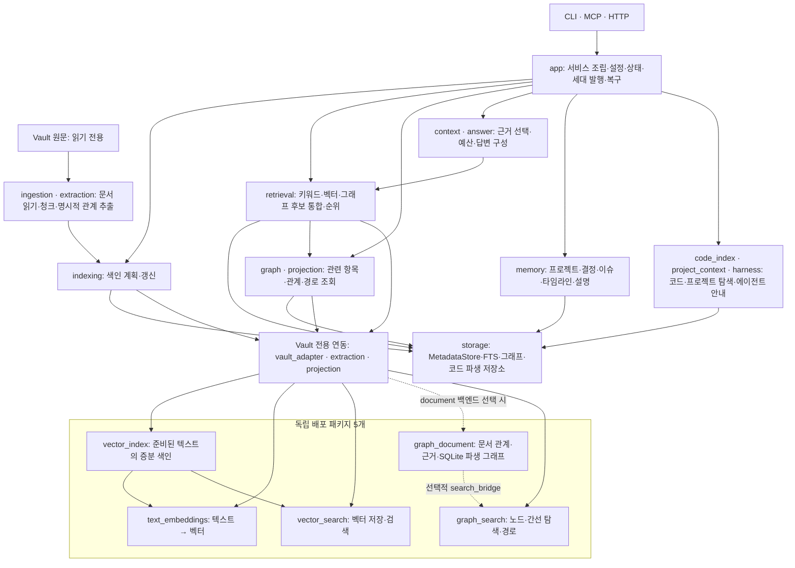

# 검색 대상·근거 연결: 의도 확인 기록

- Intent Status: Hardened
- Created: 2026-10-15
- Source: 현재 사용자의 codify 명세 작성·모듈 시각화 요청과 직전 ‘검색 대상과 근거 연결’ 내부 기능 논의
- 확인한 구현 기준: `4ea7e3c`
- Parent: [SEL-20261015](../specs/2026-10-15-search-evidence-linking-ko.md)
- Implementation: Not started — 현재 산출물은 명세이며 구현 단계와 구분한다.
- Q-01: Resolved — 역조회 설명 후 사용자 ‘추가하라’로 포함 확정

## 확정된 의도와 목표

- INT-01: 벡터 항목과 그래프 소유 노드·관계가 참조하는 문서·청크를 연결하는 책임을 Vault Graph 내부의 한 기능으로 모은다.
- GOAL-01 → INT-01: 기존 검색·그래프 조회 소비자가 같은 근거 조회 기능을 이용하면서 현재 결과·경고·순서·리비전을 유지한다.
- GOAL-02 → INT-01: 각 그래프 소유자와 근거 문서·청크의 다대다 관계를 식별자 혼동 없이 해석한다.
- INT-02: 현재 기능의 배치와 독립 패키지의 사용 위치를 볼 수 있어야 한다.
- GOAL-03 → INT-02: 현재 구현된 기능만 표시한 모듈 그림을 제공하고 새 연결 기능의 제안 상태를 구분한다.

코드는 변경하지 않는다. 별도 배포 패키지, 새로운 검색 순위 계산, 벡터 결과를 출발점으로 하는 자동 그래프 확장, 영구 매핑 DB는 이번 확정 의도에 포함하지 않는다. 역조회 전용 내부 API도 설계 범위에 포함한다. 기존 검색 흐름에 자동 적용하지 않는 조건은 유지한다.

## 현재 코드에서 확인한 사실

| 근거 | 확인한 내용 | 추출 시 보존할 조건 |
|---|---|---|
| [EvidenceResultAssembly](../../../src/vault_graph/retrieval/evidence_result_assembly.py) | 공통 후보의 `(vault_id, document_id, chunk_id)`로 MetadataStore 근거·청크를 조회한다. | 누락 카운터·경고·역할 필터·조회 순서 유지 |
| [GraphRetrievalService](../../../src/vault_graph/app/graph_retrieval_service.py) | `_resolve_graph_evidence`가 근거를 조회한다. 관계의 모든 근거가 없을 때 `graph_evidence_missing` 경고를 생성한다. | 공통 조회가 호출자의 경고 정책까지 통합하지 않음 |
| [GraphResourceService](../../../src/vault_graph/app/graph_resource_service.py) | 근거 키를 먼저 중복 제거하고 누락된 각 키에 `missing_evidence`를 생성한다. | 검색과 다른 경고 단위·순서를 유지 |
| [ReadOnlyGraphReadiness](../../../src/vault_graph/app/graph_readiness_service.py) | 그래프 근거 해시·최신성 검사를 수행한다. | 공통 기능 추출을 이유로 새로운 해시 거부 정책을 추가하지 않음 |
| [candidate_ranking](../../../src/vault_graph/retrieval/candidate_ranking.py) | 후보 통합 키는 `(vault_id, chunk_id)`이고 첫 document_id와 모든 신호를 유지한다. | 근거 키와 다르므로 이번 작업에서 통합 키를 바꾸지 않음 |
| [GraphEvidenceRef](../../../src/vault_graph/graph/graph_contracts.py) | owner_kind·owner_vault_id·owner_id와 evidence_vault_id·document_id·chunk_id를 별도로 보관한다. | 소유 Vault와 근거 Vault를 같다고 가정하지 않음 |
| [GraphStore](../../../src/vault_graph/storage/interfaces/graph_store.py) | 그래프 ID 조회는 있지만 문서·청크→소유 노드·관계 역조회 API는 없다. | 역조회는 기존 구현 완료로 표시하지 않음 |

문서·청크 하나는 여러 노드·관계의 근거가 될 수 있고, 한 소유자는 여러 근거를 가질 수 있다. 원문 경로나 제목·이름·벡터 값으로 ID를 추측하지 않는다. MetadataStore가 현재 문서·청크 근거를 제공하며 독립 패키지는 Vault ID를 해석하지 않는다.

## Q-01: 확인한 범위와 답변 기록

**질문:** 벡터 결과의 문서·청크로 관련 그래프 소유자를 찾는 역조회 계약도 포함할 것인가?

- 옵션1: 양방향 연결까지 설계한다. 역조회 입력·범위·다대다 결과·상한·불완전 결과·리비전 계약을 포함하지만 현재 검색 흐름에 자동 적용하지 않는다.
- 옵션2: 기존 기능만 통합한다. 현재 후보 ID 해석과 그래프→근거 조회만 추출하고 역조회 API는 제외한다.
- 권고: 옵션1. 직전 논의의 연결1·연결2를 함께 다룰 수 있다. 단, 기존 GraphStore에 없는 기능이므로 구현·검증 범위가 늘어난다.
- 답변: 사용자가 역조회의 의미를 물었고, 근거→그래프 소유자 조회라는 설명 후 ‘추가하라. 모듈구조를 생각해서 구현하는게 좋곘어.’라고 지시했다.
- 상태: Resolved — 옵션1의 기능 범위가 확정됐다. 상세 API와 구현 완료는 별개이다.

역조회를 포함하면 결과를 공개할 수 있는 소유 Vault와 조회 가능한 근거 Vault를 각각 검사해야 한다. 결과가 상한에 걸린 경우 빈 목록을 ‘연결 없음’으로 해석해서는 안 된다. `current_manifest` 전체를 읽고 나서 결과 상한만 적용하는 방법을 제한된 역조회라고 부르지 않는다.

## 정규화할 명세에 필요한 검증 항목

아래는 실행 결과가 아닌 향후 검증 계획이다. 명세 작성에서 새 코드·테스트는 만들지 않았다.

| 검증 대상 | 기존 증거 후보 | 새 계약에서 확인할 내용 |
|---|---|---|
| 검색·후보 통합 | tests/test_retrieval_service_search.py, tests/test_search_include_graph.py | 후보 수·신호·순서·경고·누락 수 보존 |
| 그래프·리소스 근거 | tests/test_graph_retrieval_service.py, tests/test_graph_resource_reader.py | 일부/전체 누락, 키 중복, 경고 단위의 호출자별 보존 |
| 범위·최신성 | tests/test_multi_vault_graph_retrieval.py, tests/test_graph_readiness_batch.py | owner/evidence Vault 분리, 범위 이탈 방지, 기존 최신성 정책 유지 |
| 공개·읽기 전용 | tests/test_graph_document_public_contracts.py, tests/test_search_read_only_boundary.py, tests/test_graph_retrieval_read_only_boundary.py | CLI/MCP/HTTP 결과 및 파일 해시 유지 |
| 역조회 | 새 내부 포트·실제 두 백엔드 | 없는 전용 API를 현재 기능으로 간주하지 않고 다대다·상한·부분 결과·리비전·권한을 검증 |

## 용어 초안

- **검색 대상·근거 연결 (Confirmed):** 벡터·그래프 검색 대상의 식별자를 현재 문서·청크 근거에 대응시키는 Vault 내부 기능. 출처: 사용자 요청.
- **근거 키 (Confirmed):** `(evidence_vault_id, document_id, chunk_id)` 또는 공통 후보의 동일 의미 삼중 키. 출처: MetadataStore·GraphEvidenceRef.
- **소유자 키 (Confirmed):** 소유자 종류와 해당 Vault의 노드/관계 ID. 근거 키와 별개이다. 출처: GraphEvidenceRef.
- **역조회 (Confirmed):** 근거 키에서 해당 근거를 참조하는 소유자 키들을 찾는 기능. 사용자 답변으로 명세에 포함했다.

## 현재 모듈 구조

이 그림은 코드에 존재하는 기능의 큰 구분이다. 화살표는 기능 사용 관계이며 모든 세부 호출을 나타내지는 않는다. 새 연결 기능은 아직 별도 구현되지 않았으므로 이 현재 그림에 넣지 않는다. 불변성 엔진 등 문서에만 제안된 기능도 현재 구현으로 표시하지 않는다.

## 리뷰 및 진행 상태

독립 읽기 전용 검토에서 확인한 경고 정책 차이·해시 검사 위치·후보 병합 키·역조회 부재·소유/근거 Vault 분리를 이 기록에 반영했다. 이는 정규화된 부모 명세의 리뷰 통과나 구현 승인을 뜻하지 않는다.

Q-01 답변을 반영해 새 부모 명세를 작성했다. 구체 계약의 독립 리뷰에서 SEL-R1/R2/R3을 보완했고 재검토를 통과했다. 검토 결과와 현재/제안 그림은 부모에 기록했다. 기존 부모 명세와 DECISIONS의 승인 상태는 변경하지 않는다. 이번 요청에는 Vertical Slice 작성이나 구현이 포함되지 않는다.
