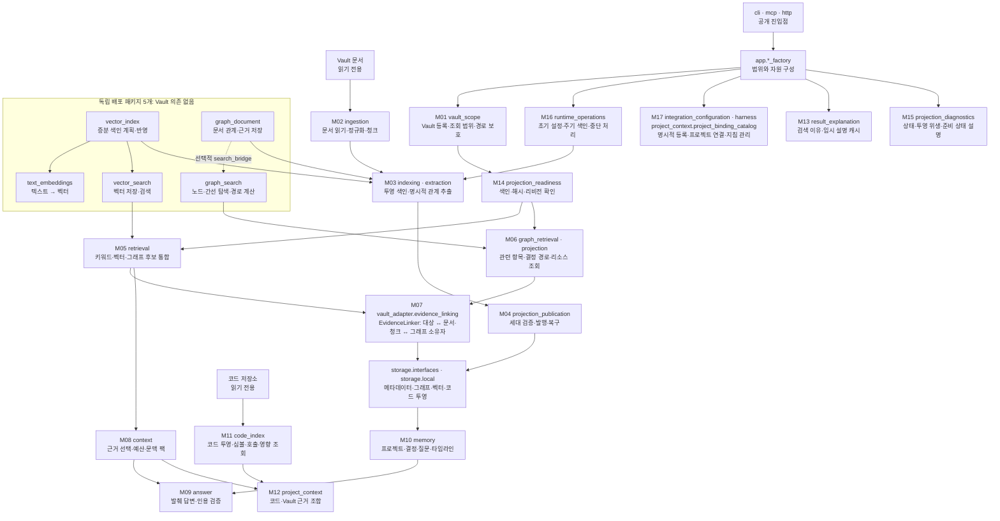

# 기능별 모듈 정리 구현·검증 기록

- Parent: [VG-MOD-20261015](../specs/2026-10-15-vault-graph-modular-architecture-ko.md)
- Related Contract: [SEL-20261015](../specs/2026-10-15-search-evidence-linking-ko.md)
- Plan: [단계0–8](../plans/2026-10-15-vault-graph-modularization-plan-ko.md)
- Status: Complete — 승인된 모듈 정리·SEL 구현·독립 결과 리뷰·시각화를 완료했다. 이후 발견한 legacy 색인 결함의 수정은 §5에 기록한다.
- 기준: `4ea7e3c` 이후 현재 작업 트리. 원래 작업 중이던 명세·결정·보정 기록을 보존했다.

## 1. 실제 기능과 구현 위치

기존에 응집된 기능은 유지했다. 상위 `app`에 있던 기능 구현을 해당 기능으로 옮기고, 이전 경로는 동일한 모듈 객체를 가리켜 기존 가져오기와 monkeypatch 경로를 보존한다. 새 범용 관리자나 독립 배포 패키지는 추가하지 않았다.

| 모듈 | 현재 구현 | 정리한 책임 |
|---|---|---|
| M01 범위·등록 | `vault_scope/`, `ingestion/vault_catalog.py` | catalog·Graph Home·안전 경로. 범위 해석은 기존 구현 재사용 |
| M02 문서 준비 | `ingestion/` | 파일 읽기·리더·정규화·청크 |
| M03 투영 색인 | `indexing/`, `extraction/` | 색인 선택·계획·반영. `IndexService` 구현을 기능 위치로 이전 |
| M04 세대 발행 | `projection_publication/` | 비공개 세대·검증·활성화·복구 |
| M05 통합 검색 | `retrieval/` | 후보·순위·주변 청크. 공통 EvidenceLinker로 근거 조회 |
| M06 그래프 조회 | `graph_retrieval/`, `projection/` | 관련 항목·결정 경로·리소스. 검색 알고리즘은 기존 패키지 사용 |
| M07 근거 연결 | `vault_adapter/evidence_linking.py`, `evidence_read_context.py`, `storage/interfaces/evidence_owner_lookup.py` | 대상→근거 및 근거→그래프 소유자. 두 백엔드의 제한 SQL 조회 |
| M08 문맥 팩 | `context/` | 기존 근거 선택·예산·문맥 팩 보존 |
| M09 발췌 답변 | `answer/` | 답변 서비스 구현을 기능 위치로 이전. 기존 수집·인용 검증 보존 |
| M10 기억 조회 | `memory/` | 프로젝트·결정·질문·타임라인. 설명 캐시와 진단 구현 분리 |
| M11 코드 투영·조회 | `code_index/` | 저장소 포트·읽기/쓰기 factory 주입. SQLite 구성은 Vault 어댑터 소유 |
| M12 프로젝트 문맥 | `project_context/` | 기존 소비자 포트 재사용. binding의 상위 app 의존 제거 |
| M13 결과 설명 | `result_explanation/` | 검색 이유와 최대 256건 임시 캐시 |
| M14 준비 상태 | `projection_readiness/` | 색인·해시·리비전 확인. 검색 응답 타입으로의 역의존 제거 |
| M15 진단 | `projection_diagnostics/` | 상태·위생·확장 준비 설명. 자동 복구하지 않음 |
| M16 실행 운영 | `runtime_operations/` | 초기 설정·주기 색인·중단. 색인 소비자 포트와 자원 정리 |
| M17 연동 설정 | `integration_configuration/`, `harness/`, `project_context/project_binding_catalog.py` | 명시적 설정 기록과 지침 관리. 각 파일 형식의 기존 구현 유지 |

CLI/MCP/HTTP는 전송 계층이다. `app`의 실제 factory는 자원 구성·주입을 유지한다. 기존 `app` 서비스 파일은 호환 경로이다. `IndexService.status()`는 기존 호출을 위해 진단 조회를 위임하는 호환 진입점으로 유지하며, 준비 상태 판정과 진단 응답의 소유자는 분리했다. 모델·설정·코드 저장소 생성의 기존 선택 인자는 어댑터에 있는 기본 factory로 보존한다.

독립 패키지는 `graph_search`, `graph_document`, `text_embeddings`, `vector_search`, `vector_index`의 기존 5개이다. 일반 패키지·저장 형식은 이번에 변경하지 않았다.

## 2. 처리 흐름

각 노드에 실제 Python 모듈·패키지 이름과 역할을 표시했다. 내부 경로는 `vault_graph` 기준이며, M 번호는 §1의 책임 경계와 대응한다. 화살표는 주요 처리 흐름이다. 모든 기능이 항상 실행되는 것은 아니다. 특히 그래프 후보는 기존처럼 선택적이며 근거 역조회는 명시적 내부 호출이다.



벡터 항목과 그래프 노드를 같은 ID로 취급하지 않는다. M07은 문서·청크의 근거 키를 기준으로 다대다 연결을 반환한다. 부분 결과·누락·준비 안 됨을 구분하고, 조회 중 세대/리비전이 달라지면 연결과 출처를 함께 초기화한다. 소유자의 마지막 변경 리비전과 조회 범위의 현재 리비전은 별도로 검증한다.

## 3. 실행 증거

변경 전 전체 검사: `uv run --python 3.12 --no-sync --all-packages --all-extras pytest -q tests packages/*/tests` → **1,352 passed, 1 skipped**.

작업별 확인: 기반 166개, 서비스 위치 정리 134개, 코드·프로젝트 175개, 실행·설정 44개를 각 작업자가 확인했다. 겹치는 테스트가 있으므로 합산하지 않는다. 최종 완료 판정에는 아래 root 통합 결과를 사용한다.

| 검사 | 실제 결과 |
|---|---|
| 통합 전체 pytest | 공식 MCP stdio를 활성화한 최종 실행 **1,468 passed, 0 skipped**, 22.19초. 첫 통합 실행의 경계 검사 실패는 이전 파일 경로를 읽었기 때문이며 실제 구현 경로에서 같은 제약을 검사하도록 수정했다. |
| Ruff / 형식 / strict mypy | 전체 Ruff 통과, 423개 Python 파일 형식 통과, 403개 소스·테스트 파일 타입 검사 통과 |
| 독립 wheel | 최종 소스에서 `uv run --python 3.12 --no-sync python tests/verify_graph_module_wheels.py` 통과. SHA256 확인한 6개 wheel·root-only 설치·그래프 bridge·벡터 pipeline·Vault 어댑터 실행. 재실행 중 로컬 HTTP 클라이언트 연결 종료 traceback이 있었으나 검증기는 모든 결과를 확인하고 exit 0으로 종료 |
| 문서 그래프 성능 | [새 측정](2026-10-15-modular-document-backend-performance.json): 1,000문서·4KiB, open p95 1,379.418ms, related p95 151.048ms. 기존 세 목표와 원본/Data Home 무변경 검사 통과 |
| 근거 역조회 비용 | [분리 측정](2026-10-15-evidence-linking-performance.json): 같은 1,000문서에서 open p95 1,447.715ms, 기존 readiness 78.461ms, 신규 제한 조회 0.765ms, 전체 연결 요청 147.568ms. 각 3회 준비·20회 측정. 두 경로의 동일한 7개 소유자·원본/파생 hash 보존. 새 SLA가 아님 |
| 독립 리뷰 | **최종 결과 리뷰 PASS**. 별도 리뷰 에이전트가 VG FA-01–06·SEL FA-01–10, 실제 지도·성능·추가 경계 증거를 대조했다. R3 local/cross scope 대체, R4 누락 근거의 출처, R5 관계 끝점 타입을 보정 후 재검증. 최종 3개 SEL 테스트 파일을 독립 실행해 **61 passed**. 전체 검사·wheel·성능은 root/측정 작업자의 증거이며 리뷰어가 중복 실행했다고 주장하지 않음 |

조건부였던 MCP 검사를 이번 최종 실행에서는 실제 실행했다. 남은 경고 하나는 기존 Starlette의 `httpx` TestClient 사용 중단 예고이다. 모델 다운로드나 원격 서비스가 이 검사에서 실행됐다는 뜻은 아니다.

| 계획 단계 | 구현·증거 |
|---|---|
| 단계0 | 변경 전 1,352 passed/1 skipped, 기존 공개 경로·fixture 유지 |
| 단계1 | M01/M04/M14 실제 구현 이전, module/class identity·scope/readiness·발행/복구 검사 |
| 단계2 | M02의 기존 응집성 유지, M03 구현 위치 분리. 전체/증분/삭제·backend 전환 회귀. 기존 legacy 실패 사례는 §5에 별도 기록 |
| 단계3 | 새 M07·두 backend 제한 조회·기존 세 소비자의 공통 근거 조회·실제 factory 연결 |
| 단계4 | M05 기존 순위/결합 보존, M06 구현 이전·기존 CLI/MCP/HTTP 차등 회귀 |
| 단계5 | M08/M10 기존 구현 재사용, M09 구현 이전, 문맥·인용·기억·read-only 전체 회귀 |
| 단계6 | M11 저장소 factory 주입·상태 포트 분리, M12의 상위 의존 제거. 코드/프로젝트 175개 관련 검사 |
| 단계7 | M13/M15 분리·M16 소비자 포트·M17 설정 소유권, 중단/실패/사용자 설정 보존 회귀 |
| 단계8 | root의 전체 1,468개·정적 검사·독립 wheel·성능·최종 결과 리뷰 |

## 4. 수용 기준 감사

| 기준 | 증거와 완료 조건 |
|---|---|
| VG FA-01 | §1의 M01–M17 및 지원 계층 소유권, 기존 5개 패키지 |
| VG FA-02 | `test_functional_module_boundaries.py`, foundation/code/project/runtime import 경계·모듈 identity 검사 |
| VG FA-03 | 기존 CLI/MCP/HTTP 전체 회귀, 공개 그래프 차등 테스트 |
| VG FA-04 | 기존 세대 발행·중단/복구·source read-only 검사, 실제 factory 역조회 hash 검사 |
| VG FA-05 / SEL FA-01–09 | `test_evidence_linking.py`, `test_evidence_owner_lookup.py`, 추가 경계 검사, 기존 근거 소비자 회귀·wheel |
| VG FA-06 | 단계0–8 변경과 검증, 별도 구현·결과 리뷰 지적 해결 후 통합 검사 |
| SEL FA-10 / 시각화 | §1–2의 실제 코드 기준 모듈 지도. 역사적 설계 그림과 현재 구현 구분 |

실제 모델 품질·다운로드, 외부 배포·원격 CI 실행을 이번 작업의 증거로 주장하지 않는다. 기존 deprecation 경고와 조건부 skip은 실제 최종 검사 결과와 함께 기록한다. 원본 내용·스키마·일반 패키지 변경은 없다.

## 5. 발견한 기존 결함과 후속 수정

최초 모듈화 검증에서는 legacy SQLite의 문서 교체 후 재색인 발행 실패를 기존 결함으로 분리했다. 당시 `--full`도 같은 사례에서 실패했고 document 백엔드에서는 통과했다. 이후 사용자의 ‘이거 수정하라’ 지시에 따라 아래와 같이 수정했다.

별도 작업자가 `git archive 4ea7e3c`의 격리된 원본 코드로 같은 오류를 재현했다. 기존 두 문서 중 Source 본문을 교체한 뒤 CLI index를 실행하면 삭제된 청크를 가리키는 3개 참조가 남는다. 둘은 활성 엔터티, 하나는 더 이상 사용하지 않는 관계의 참조이다. `SQLiteGraphStore.apply_reconcile_plan`의 기존 근거 upsert/보존 동작이 원인이며, 이번 추가 조회 메서드나 기능 이전에서 발생한 회귀가 아니다. 실패 시 활성 세대와 원본의 해시는 보존된다.

**수정:** `SQLiteGraphStore.apply_reconcile_plan`의 기존 트랜잭션 안에서 교체·삭제 대상 소유자의 이전 근거와 선택 범위의 더 이상 사용되지 않는 근거를 정리한다. 현재 계획의 근거, 다른 Vault·문서 범위의 근거, 경로를 확인할 수 없는 근거는 보존한다. 사라진 범위의 local/cross 항목을 함께 제거하고, 다른 범위에 근거가 남은 공유 소유자는 활성 상태를 유지한다. 근거가 없는 과거 레코드는 조회에서 제외하되 tombstone 기록은 유지한다. 위생 검사·원본·저장 스키마를 바꾸지 않았다.

**회귀 검증:** `tests/test_legacy_graph_reindex.py`에서 실제 CLI의 문서 교체/삭제 × 일반/전체 색인을 각각 두 번 수행하고 원본·이전 세대 해시 보존을 검사한다. 공유 범위·다른 Vault·local/cross, SQL 실패 롤백, 과거 근거 정리, 경로 미확인 근거와 미언급 소유자 보존, 변경 없는 소유자의 근거 보존, 경로의 `%`·`_` 문자 처리를 포함한 10개 검사가 통과했다. 추가 검사 과정에서 두 fixture가 같은 고유 근거 키를 중복 사용한 오류는 서로 다른 유효 참조 키로 수정했으며, 생산 코드의 제약을 느슨하게 바꾸지 않았다.

**최종 결과:** 후속 수정 소스에서 공식 MCP stdio를 활성화한 전체 검사 **1,478 passed, 0 skipped, 24.02초**. Ruff 전체 통과, 424개 파일 형식 검사와 404개 소스·테스트 타입 검사 통과. 별도 리뷰 에이전트가 10개 회귀를 독립 실행해 **10 passed, 1.25초**, 최종 PASS를 반환했다. §3의 wheel·성능 측정 수치는 모듈화 완료 시점의 증거이며 이번 보정에서 재측정했다고 주장하지 않는다.

이 수정은 확인한 재색인 결함을 해결하는 범위이다. 모든 기존 색인 결함의 해결이나 전체 배포 환경의 production ready 판정을 의미하지 않는다.

## 6. 재현 명령

```sh
VG_RUN_MCP_STDIO_SMOKE=1 uv run --python 3.12 --no-sync --all-packages --all-extras pytest -q tests packages/*/tests
uv run --python 3.12 --no-sync ruff check src tests packages
uv run --python 3.12 --no-sync ruff format --check src tests packages
uv run --python 3.12 --no-sync mypy src tests packages/text-embeddings/src packages/vector-search/src packages/vector-index/src
uv run --python 3.12 --no-sync python tests/verify_graph_module_wheels.py
uv run --python 3.12 --no-sync python -m tests.benchmarks.measure_evidence_linking
```

문서 그래프 성능은 기존 측정기를 사용하고 `REPORT_PATH`만 새 날짜 경로로 지정했다. 과거 측정 원본을 덮어쓰지 않았다.
