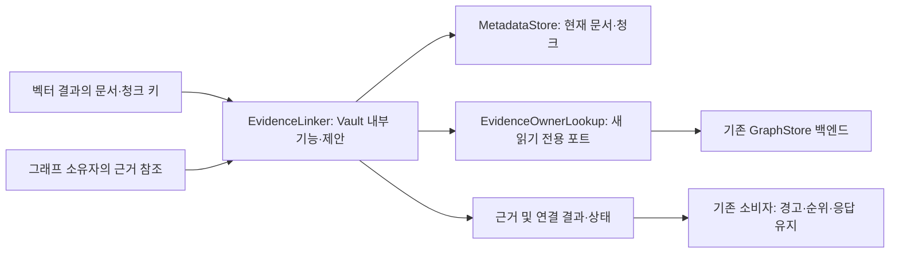
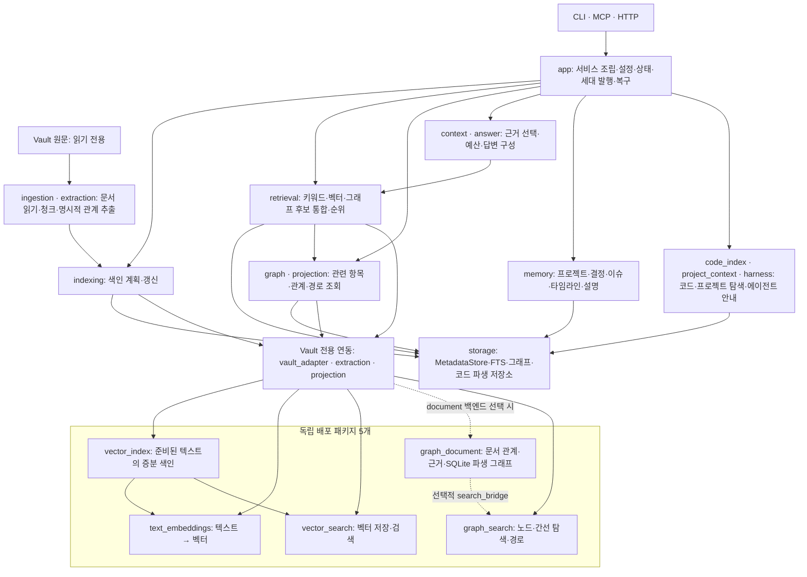

# 검색 대상·근거의 양방향 연결

- Contract ID: SEL-20261015
- Contract Status: Approved — 후속 명세·계획 구현 지시. [승인 기록](../../DECISIONS.md#vg-mod-20261015-implementation)
- Intent Status: Hardened
- Created: 2026-10-15
- Source: User instruction — ‘검색 대상과 근거 연결’ 내부 기능의 명세·현재 모듈 시각화 요청, 역조회 설명 뒤 ‘추가하라. 모듈구조를 생각해서 구현하는게 좋곘어.’라는 범위 확정
- Intent Record: [의도 확인과 기존 코드 근거](../intents/2026-10-15-search-evidence-linking-ko.md)
- Decision Records: [승인된 기능 범위](../../DECISIONS.md#sel-20261015-scope)
- Glossary: [SEL 용어](../glossary.md#sel-20261015)
- Implementation: Complete — [구현·검증·현재 그림](../reports/2026-10-15-modularization-completion-ko.md). 아래 기준선과 역사적 현재 그림은 설계 당시 상태이다.
- Independent Implementation / Outcome Review: Passed — FA-01–10과 두 실제 backend 경로를 검토했고 최종 SEL 검사 61개를 독립 실행했다.
- Independent Design Review: Passed — 2026-10-15. 별도 리뷰 에이전트가 SEL-R1/R2/R3 수정 뒤 재검토했다. 설계 검토이며 구현 검증은 아니다.
- 확인한 구현 기준: `4ea7e3c`

## 1. 문제와 목표

벡터 결과와 그래프의 노드·관계는 서로 다른 ID를 사용한다. 실제 연결은 해당 대상이 참조하는 문서·청크 근거를 통해 이루어진다. 현재 근거 조회가 검색 결과 구성·그래프 조회·리소스 조회에 흩어져 있고, 문서·청크에서 그래프 소유자를 찾는 전용 API는 없다.

이 책임을 Vault 내부의 한 기능으로 모은다. 호출자는 저장소 구조나 ID 인코딩을 해석하지 않고, 검색 대상에서 현재 근거를 찾거나 근거에서 관련 그래프 소유자를 찾을 수 있어야 한다. 독립 패키지에 Vault 정책을 넣지 않는다.

| 의도 | 관찰 가능한 목표 |
|---|---|
| INT-01: ID 해석과 근거 연결 책임을 모은다. | GOAL-01: 기존 검색·그래프·리소스 조회가 공통 근거 조회를 사용해도 현재 결과·경고·순서·리비전을 유지한다. |
| INT-01 | GOAL-02: 벡터 결과의 문서·청크로 관련 노드·관계를 빠짐·추측 여부가 드러나는 다대다 결과로 조회한다. |
| INT-02: 모듈 간 책임과 실제 구현 상태를 이해할 수 있어야 한다. | GOAL-03: 현재 구조와 연결 기능을 추가할 제안 구조를 구분한 그림을 제공한다. |

## 2. 범위

**포함:** 후보/벡터 메타데이터→근거 키 변환, 근거 키→MetadataStore 조회, 그래프 근거 참조→동일 조회, 근거 키→그래프 소유자 역조회, 읽기 전용 조립·연동, 기존 호출자의 경고 정책 보존.

**제외:** 새 배포 패키지, 영구 ID 매핑 DB, 임베딩 재생성, 유사도로 관계 추측, 문서 ID와 개념 노드 ID의 1:1 대응, 순위·점수 변경, 자동 그래프 확장 검색, 새 CLI/MCP/HTTP 명령, 색인·스키마 이전·원문 수정. 역조회 결과는 탐색 시작점 후보로 쓸 수 있지만 이번 기능이 자동으로 경로를 탐색하지 않는다.

[벡터 모듈 계약](2026-10-06-vector-modules-ko.md), [그래프 투영 연동](2026-10-03-graph-search-integration-ko.md), [문서 그래프 연동](2026-10-04-graph-document-integration-ko.md)을 대체하거나 수정하지 않는다. 일반 패키지의 ID 복원·점수·해시 정책은 기존 어댑터에 남긴다.

## 3. 호출자와 전제

- 호출자: Vault의 검색·그래프·리소스 서비스. 역조회는 내부 소비자의 명시적 호출로만 실행한다.
- MetadataStore·GraphStore·catalog/실제 조회 범위는 기존 factory가 조립한다. 연결 기능이 Data Home을 열거나 현재 세대를 임의로 다시 선택하지 않는다.
- QueryScope는 조회 범위 정책이다. 이 기능은 별도 인증 체계를 추가하거나 범위만으로 인증 완료를 주장하지 않는다.
- 벡터 검색은 기존 어댑터가 복원한 vault/document/chunk 필드를 전달한다. 일반 `record_id`를 문자열 분해하거나 `graph_search`의 요청 한정 node_id를 영구 키로 저장하지 않는다.

## 4. 현재 사실과 보존 경계

| 현재 위치 | 확인한 사실 | 보존할 동작 |
|---|---|---|
| retrieval/evidence_result_assembly.py | 후보의 삼중 키로 근거·청크를 조회한다. | 누락 수·역할 필터·경고·결과 구성은 기존 소비자가 유지 |
| app/graph_retrieval_service.py | 근거를 조회·중복 제거하고, 관계의 근거가 모두 없으면 graph_evidence_missing을 만든다. | 일부 누락을 모두 새 경고로 바꾸지 않음. 근거 없는 간선은 기존처럼 탐색 전에 제외 |
| app/graph_resource_service.py | 키를 먼저 중복 제거하고 각 누락 키에 missing_evidence를 만든다. | 검색과 다른 경고 단위·순서·대상 Vault 유지 |
| app/graph_readiness_service.py | 그래프 근거 해시·리비전·준비 상태를 검사한다. | 추출과 함께 새 해시 거부 규칙을 기존 정방향 호출에 적용하지 않음 |
| retrieval/candidate_ranking.py | 후보 병합은 (vault_id, chunk_id), 근거 조회는 삼중 키이다. | 병합 키·첫 document_id 선택·신호 중복·순위를 변경하지 않음 |
| storage/interfaces/graph_store.py | 그래프 ID 조회는 있지만 근거→소유자 조회는 없다. | 역조회는 새 내부 계약이며 현재 구현 완료로 표시하지 않음 |

## 5. 모듈 구조 제안

핵심 구현 위치는 `vault_graph/vault_adapter/evidence_linking.py`, 내부 진입점은 `EvidenceLinker`로 제안한다. 이름·파일 배치는 상세 설계안이며 기존 클래스 이름을 이번 문서 작업에서 변경하지 않는다.

| 구분 | 소유할 책임 | 소유하지 않는 책임 |
|---|---|---|
| EvidenceLinker | 근거 키 정규화, 현재 근거 조회, 양방향 연결 결과 검증 | 점수·순위·문서 역할 필터·사용자 경고 문구 |
| 저장소의 EvidenceOwnerLookup 포트 | 범위가 제한된 근거→소유자 조회와 조회 리비전·완전성 보고 | 검색 전략·경고·Vault 파일 읽기 |
| 기존 소비자 | 반환한 사실을 기존 DTO·경고·누락 수로 변환 | 저장소 테이블이나 일반 패키지 ID 인코딩 해석 |
| 기존 readiness/factory | 준비 상태·동일 읽기 문맥·선택 세대 관리 | 연결 기능을 이유로 새 색인이나 복구 실행 |

메타데이터만 필요한 호출은 GraphStore·모델을 열지 않는다. 역조회 제공자는 명시적으로 주입하고, 제공자가 없으면 ‘조회 불가’를 반환한다. 빈 성공 결과로 대체하지 않는다. 새 포트는 GraphStore의 기존 필수 메서드를 무조건 늘리기보다 별도 읽기 전용 역량으로 주입해 기존 소비자를 보존한다. 실제 운영 연결 완료에는 legacy SQLite와 document 백엔드 모두의 지원 증거가 필요하다.



일반 `vector_search`, `vector_index`, `graph_document`, `graph_search`가 이 기능을 가져오는 역방향 의존성은 금지한다. `EvidenceLinker`도 검색 서비스나 factory를 가져오지 않는다.

## 6. 데이터와 내부 인터페이스 제안

Python 표기는 형태를 설명하는 의사 인터페이스이며 실행 코드가 아니다.

```python
EvidenceKey = tuple[str, str, str]  # evidence_vault_id, document_id, chunk_id
GraphOwnerKey = tuple[str, str, str]  # owner_kind, owner_vault_id, owner_id

class EvidenceLinker:
    def resolve_evidence(self, keys: tuple[EvidenceKey, ...]) -> tuple[EvidenceResolution, ...]: ...
    def find_graph_links(self, request: GraphLinksRequest) -> GraphLinksResult: ...
```

### 6.1 기존 근거 조회

`EvidenceResolution`은 입력 키와 `EvidenceReference | None`만 돌려준다. 입력 순서와 중복 항목을 보존하고, 같은 키의 저장소 읽기는 요청 안에서 재사용할 수 있다. 한 번의 결과가 맞는 삼중 키의 현재 근거·청크인지 확인한다. 데이터 불일치/저장소 실패를 단순 ‘근거 없음’으로 바꾸지 않는다.

호출자가 GraphEvidenceRef의 evidence 필드로 키를 만든다. 공통화할 변환 로직은 같은 파일의 내부 함수로 둔다. 소유자 ID와 일반 노드 ID를 근거 키로 추측하는 별도 변환 계층을 만들지 않는다. 공통 결과 자체는 경고·중복 제거·역할 필터·새 해시 검증을 강제하지 않는다.

### 6.2 신규 역조회 입력

`GraphLinksRequest`는 근거 키 목록, catalog로 확정한 actual_scopes, include_cross_vault, 양의 `max_keys`와 `limit`를 받는다. max_keys는 중복 제거 전 입력 수의 상한, limit는 반환할 고유 연결의 전체 상한이다. 값은 호출자가 명시하며 임의의 운영 SLA를 넣지 않는다.

입력 키는 벡터 신호가 없어도 사용할 수 있다. 문서 전체 조회가 필요하면 기존 MetadataStore로 허용된 청크를 선택한 뒤 명시적 키 목록을 넘긴다. 와일드카드나 제목 유사도를 역조회 키로 쓰지 않는다.

### 6.3 신규 역조회 출력

- `links`: `GraphOwnerKey`, `EvidenceKey`, `evidence_ref_id`, 현재 `EvidenceReference`, 해당 소유자의 graph revision을 포함한 연결 목록. 노드/관계 종류와 두 Vault를 별도로 보관한다.
- `outcomes`: 원래 입력 위치별 키·상태(`linked`, `no_links`, `missing_evidence`, `not_ready`, `not_processed`)·`key_complete: bool`. `linked`는 연결이 하나 이상 있다는 뜻이며 전체 연결을 다 찾았다는 뜻은 아니다. 중복 입력의 상태·완료 여부는 같은 키끼리 동일하고 links를 불필요하게 늘리지 않는다.
- `coverage`: `complete` 또는 `partial`. 모든 입력의 조회를 결론 낼 수 있었는지를 뜻하며, 모든 입력에 근거가 존재한다는 뜻은 아니다.
- `stop_reason`: `completed`, `result_limit`, `not_ready`, `revision_changed`, `lookup_unavailable`.
- `source_revisions`: 성공 또는 result_limit 부분 결과에서 실제 사용한 메타데이터·그래프 리비전과 선택 세대 식별자(존재하는 경우). graph_document의 revision을 legacy graph revision으로 바꿔 쓰지 않는다.

`no_links`는 해당 키가 현재 존재하고 허용 범위의 조회를 완료했으나 연결이 없을 때만 쓴다. 원문 삭제는 `missing_evidence`, 준비되지 않은 그래프는 `not_ready`로 구분한다. 한 키에서 소유자 둘 중 하나만 반환하면 `linked`와 `key_complete=false`이다. 조회하지 못한 후속 키는 `not_processed/false`이다. 범위 내 조회를 끝낸 `linked`, `no_links`, 존재 확인을 끝낸 `missing_evidence`는 key_complete=true이다. not_ready는 false이다. false인 키가 하나라도 있으면 coverage는 partial이다. 빈 부분 결과를 ‘관계 없음’으로 표현하지 않는다.

## 7. 규칙과 처리 순서

- INV-01: 매핑의 단위는 근거 키와 소유자 키의 다대다 연결이다. 같은 이름이나 같은 문자열 ID가 같은 대상을 뜻하지 않는다.
- INV-02: 조회는 원문·파생 DB·캐시·manifest를 생성하거나 수정하지 않는다. 기존 generation 발행과 ID·스키마를 변경하지 않는다.
- INV-03: 새 역조회는 입력 근거와 반환 소유자 양쪽의 실제 조회 범위를 검사한다. 관계는 source/target 끝점과 소유자 범위를 기존 cross-Vault 정책으로 확인한다. evidence Vault 허용이 owner Vault 허용을 뜻하지 않는다.
- INV-04: 근거의 MetadataStore 존재·경로 범위 확인과 기존 readiness 확인을 거친 키에만 그래프 조회를 실행한다. 기존 정방향 소비자의 필터·경고 순서를 이번 추출로 바꾸지 않는다.
- INV-05: SQL의 범위·삼중 키 조건으로 후보를 줄이고 허용된 연결에 limit를 적용한다. 전체 `current_manifest`를 만든 뒤 잘라서 제한 조회라고 보고하지 않는다. 일반 패키지에 역색인이나 Vault 정책을 추가하지 않는다.
- INV-06: 저장소 포트는 소유자 존재·원본 참조 소속·scope membership을 제한된 JOIN/EXISTS로 확인하고 owner/evidence 키·일치하는 참조·소유자 revision·관계 끝점 등 필요한 최소 필드만 반환한다. 링커는 키·현재 근거·범위·리비전·결과 수·완료 상태의 일관성을 확인한다. 전체 owner.evidence_refs를 다시 불러와 검증하지 않는다. 범위 밖 결과나 모순된 완료 상태는 `invalid_lookup_result`로 실패하며 그 내용을 외부 경고에 노출하지 않는다.
- INV-07: 순서는 입력 키의 첫 등장 순서, 그 안에서 `(owner_kind, owner_vault_id, owner_id, evidence_ref_id)` 순이다. 서로 다른 근거 참조 위치는 유지한다. 중복 제거는 owner+evidence_ref identity에만 적용하며 기존 후보 병합과는 별개이다.

**정방향 흐름:** 소비자가 현재 정책으로 입력을 선택 → 키 변환·공통 근거 조회 → 기존 소비자가 중복 제거·경고·카운터·순위·응답 구성.

**역방향 흐름:** 요청 형식·입력 상한 확인 → 범위 밖 Vault 사전 거부 → 역조회 제공자 존재 확인 → MetadataStore에서 키·경로 확인 → readiness 및 읽기 문맥 확인 → 저장소의 삼중 키 기반 제한 조회 → 소유자·참조·범위·리비전 검증 → 중복·정렬·상한과 위치별 결과 반환. 그래프 확장이나 후보 순위 재계산은 하지 않는다.

## 8. 실패·일관성·호환성

| 상황 | 계약 |
|---|---|
| 빈 키 목록 | 요청 형식·양의 정수 상한 검사 뒤 저장소/모델 호출 없이 completed·complete, links=(), outcomes=(), source_revisions=() |
| 빈 ID·잘못된 종류·상한 초과 | 저장소 조회 전 입력 오류. 공개 API의 새 오류로 자동 노출하지 않음 |
| 요청 Vault/근거 경로가 허용 범위 밖 | 역조회 범위 오류. 범위 밖 소유자·문서의 존재나 제목은 반환하지 않음 |
| 일부 근거 누락 | 역조회는 위치별 missing_evidence. 정방향 소비자의 기존 경고·누락 수 보존 |
| graph lookup 부재 | 비어 있지 않은 요청에서 제공자가 없으면 lookup_unavailable·partial, links=(), 모든 outcomes=not_processed/false, source_revisions=(). 연결 없음 성공으로 위장하지 않음 |
| graph lookup 실행 실패 | 기존 저장소 예외를 전달한다. 부분 성공 결과를 반환하지 않는다. 호출자는 새 읽기 문맥에서 재시도 |
| stale/incompatible/missing 그래프 | 기존 readiness로 제외하고 not_ready·partial. 자동 재색인이나 legacy fallback 금지 |
| 결과 상한 도달 | result_limit·partial. 같은 키의 일부 연결은 linked/false, 후속 미조회 키는 not_processed/false. 한 키를 끝냈으면 true를 유지한다. 실제 같은 읽기 문맥의 source_revisions만 반환 |
| 내용 해시 불일치 | 신규 역조회는 기존 readiness 경로를 통해 해당 범위를 not_ready로 처리. 정방향 공통화가 새 거부 정책을 추가하지 않음 |
| 조회 중 세대/리비전 변화 | 기존 읽기 핸들·선택 세대를 고정한다. 같은 문맥을 입증할 수 없으면 revision_changed·partial, links=(), 모든 outcomes=not_ready/false, source_revisions=()로 반환한다. 이전 linked 상태나 혼합 리비전을 남기지 않음 |
| 재시도·동시 작성 | 새 읽기 문맥에서 재시도. 여러 저장소에 걸친 선형 일관성·잠금·원자적 스냅샷은 주장하지 않음 |

모든 근거 누락과 저장소 예외를 구분한다. not_ready로 처리한 키를 제외하고 완료된 범위의 연결은 유지할 수 있으며, 이 경우 키별 key_complete와 실제 사용한 리비전을 함께 반환한다. 단, revision_changed와 lookup_unavailable의 전역 초기화 규칙은 위 표를 따른다. 새 결과의 실패 상태를 기존 SearchWarning으로 변환하는 경로는 이번에 추가하지 않는다. 구현 중 기존 호출자의 범위/해시 결함이 확인되더라도 몰래 정책을 강화하지 않고 별도 수정으로 다룬다.

## 9. 결정과 설계 상태

| ID | 결정 | 근거·대안·영향 | 상태 |
|---|---|---|---|
| D-01 | Vault 내부 양방향 연결 기능으로 명세화한다. | 사용자 추가 지시. 대안은 현재 정방향 조회만 통합. 범위에 역조회를 포함하되 자동 그래프 확장은 제외. GOAL-01/02·INV-01/02 | Accepted — [프로젝트 결정 기록](../../DECISIONS.md#sel-20261015-scope) |
| D-02 | 일반 패키지의 Vault 독립성과 기존 공개 검색 동작을 보존한다. | 기존 승인 계약과 범위 질문의 보존 조건. 코어가 Vault를 해석하는 대안은 거부. INV-02/03 | Accepted — 같은 기록과 기존 벡터 모듈 결정 |
| P-01 | EvidenceLinker+저장소 포트, 위치별 결과·부분 조회 계약 | 위 §5–8의 설계안. 별도 영구 매핑 DB보다 기존 키·참조를 재사용한다. | Accepted — 후속 구현 지시, 위 승인 기록 |

## 10. 품질 조건과 가정

- ASM-01: 운영 factory가 같은 선택 세대의 MetadataStore와 GraphStore를 제공할 수 있다. 틀리면 신규 역조회는 일관성을 입증할 때까지 not_ready로 제한한다. factory와 세대 교체 테스트로 확인한다.
- ASM-02: 기존 SQL/복원 메모리 백엔드에서 schema 변경 없이 삼중 키와 scope로 제한 조회를 구현할 수 있다. 두 백엔드의 실제 조회 계획과 상한 테스트로 확인한다. 성능 때문에 새 인덱스·스키마가 필요하면 이 계약을 별도로 개정하며 승인 없이 추가하지 않는다.
- 상한은 입력 수·반환 연결 수와 **신규 역조회·검증이 읽는 최소 연결 행**에 적용한다. 포트의 후보 데이터는 전체 limit+1 이하로 제한하고, 초과 확인에 쓴 행은 결과에 포함하지 않는다. 기존 readiness의 전체 manifest 읽기, document 백엔드 최초 복원·열기 비용은 이 상한 밖이다. 이를 포함한 전체 작업량·메모리·지연시간을 보장한다고 주장하지 않는다. 초 단위 SLA와 처리량 목표는 새로 정하지 않으며 준비 비용과 신규 조회 비용을 분리 측정한다.
- 기존 클래스/패키지 가져오기·생성자·CLI/MCP/HTTP 형태, 경고·필터·중복·리비전은 검증 전까지 보존한다. 의존성·모델 다운로드를 추가하지 않는다.

## 11. 기능 수용 기준과 검증 계획

아래는 구현 후 필요한 증거이며 이번 명세 작업에서 테스트를 실행·통과했다는 뜻이 아니다.

| ID | 수용 기준 | 검증 경로 |
|---|---|---|
| FA-01 | 기존 검색·그래프·리소스 조회가 공통 근거 기능을 사용하면서 결과·경고·누락 수·순서가 동일해야 한다. | retrieval_service_search, graph_retrieval_service, graph_resource_reader, search_include_graph 기존 공개 테스트 |
| FA-02 | 같은 삼중 키·다른 owner, 같은 owner·여러 키, 여러 anchor, 동명/동일 ID의 다른 Vault를 구분해야 한다. | 새 내부 두 메서드의 다대다·ID 충돌 공개 계약 테스트 |
| FA-03 | 실제 문서·청크가 없는 경우와 연결 없는 경우, 같은 키의 일부 연결 및 후속 미조회 키를 구분해야 한다. | 빈 입력·누락·없는 연결·소유자 둘인 한 키에 limit=1·미조회 후속 키·중복 입력 |
| FA-04 | owner/evidence Vault 및 관계 양쪽 끝점의 범위를 확인하고 범위 밖 정보를 반환하지 않아야 한다. | multi_vault_graph_retrieval 기존 경계 + 신규 역조회 반례 |
| FA-05 | 결과 정렬·상한·coverage·키별 outcomes가 일치하고 잘못된 제공자 출력을 성공으로 처리하지 않아야 한다. | 초과/범위 이탈/잘못된 키·리비전·부분 상태 제공자 입력 |
| FA-06 | 기존 readiness 위치를 유지하고 stale·세대 변화·제공자 부재를 연결 없음으로 표현하지 않아야 한다. | graph_readiness_batch·세대 전환·실패 주입 후 links/outcomes/source_revisions의 동시 초기화 |
| FA-07 | 두 운영 그래프 백엔드에서 같은 역조회 계약을 만족하며 실제 factory가 새 기능을 주입해야 한다. | legacy SQLite/document 백엔드 + 실제 factory 경로 |
| FA-08 | 원문·파생 저장소·캐시·manifest 해시가 조회 전후 같고 모델/Chroma 쓰기 클라이언트를 로드하지 않아야 한다. | 기존 search/graph_read_only_boundary + 신규 역조회 해시·가져오기 검사 |
| FA-09 | generic 패키지에 Vault 의존성이 생기지 않고 기존 CLI/MCP/HTTP·컨텍스트 경로가 유지되어야 한다. | 독립 wheel 검증·graph_document_public_contracts·context_pack·기존 전체 검사 |
| FA-10 | 현재 기능 그림과 새 기능의 제안 위치가 구현 상태를 정확히 나타내야 한다. | 코드 경로·이 문서 §5·의도 기록의 현재 그림 대조 |

## 12. 남은 결정과 승인 상태

Q-01은 사용자 설명 요청과 ‘추가하라’ 답변으로 해결됐다. 후속 명세·계획 구현 지시로 상세 내부 API·조회 결과/실패 계약 P-01도 수락했다. 차단되는 의도 질문은 없다. 구현 완료 여부는 실제 증거로 별도 판정한다.

기술 가정 ASM-01/02는 구현 증거로 확인해야 한다. 보존 조건이나 schema를 바꾸어야 한다면 별도 개정 대상이다. 부모 명세 승인만으로 구현 슬라이스가 승인되는 것은 아니다.

## 13. 완료 기준

**명세 제출:** 의도 정리, Q-01 반영, 프로젝트 결정·용어 링크, 독립 설계 리뷰의 지적 해결, 문서 경로/기존 계약 무변경 확인, 현재/제안 구조 시각화.

**향후 기능 구현:** FA-01–10의 실제 증거, 두 백엔드와 factory 연결, 관련/전체 회귀·정적 검사, 읽기 전용·실패·재시도·독립 사용 검증이 모두 필요하다. 이번 문서 제출을 기능 구현·production-ready 완료로 부르지 않는다. 이번 Specify 작업은 슬라이스·테스트·운영 코드를 생성하지 않는다.

## 14. 현재 구현의 모듈 구조

아래는 `4ea7e3c`에서 확인한 기능 묶음과 주요 사용 관계다. 새로운 EvidenceLinker는 아직 구현되지 않았으므로 이 현재 그림에는 넣지 않는다. 제안 위치는 §5에 별도로 표시했다. 점선은 현재 제공되는 선택적 연결이다. 독립 모듈은 Vault를 가져오지 않는다.


