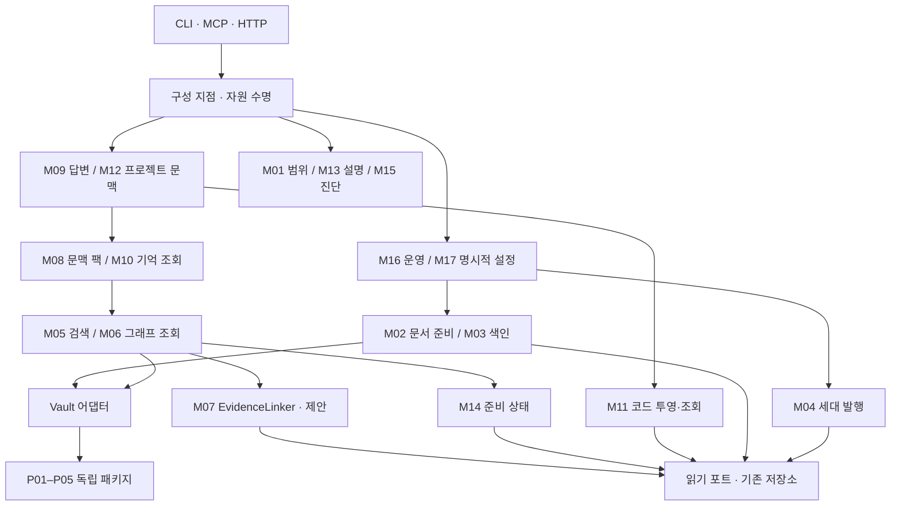

# Vault Graph 기능별 모듈 구조 최종 제안

- Contract ID: VG-MOD-20261015
- Contract Status: Approved — 사용자의 후속 구현 지시로 Q-01/Q-02를 수락했다.
- Intent Status: Hardened
- Created: 2026-10-15
- Source: User instruction — 독립 모듈 5개와 검색 대상·근거 연결 명세를 포함하고, 나머지 현재 기능의 모듈 구조와 구현 계획까지 완성해 제안한다.
- Independent Design Review: Passed — 2026-10-15. 별도 리뷰 에이전트가 전체 기능 범위·SEL 계약·세대 발행·쓰기 예외·단계별 검증을 검토했다. 구현 검증은 아니다.
- Implementation: Complete — [실제 구현·검증·현재 소유권 지도](../reports/2026-10-15-modularization-completion-ko.md). 당시 발견한 legacy 색인 결함은 후속 사용자 지시로 수정했으며 완료 기록 §5에 설명한다.
- Independent Implementation / Outcome Review: Passed — 최종 VG FA-01–06·SEL FA-01–10 대조, 독립 SEL 검사 61개 통과.
- 확인 기준: `4ea7e3c` 및 현재 작업 트리의 SEL-20261015 명세
- 구현 계획: [기능별 전환 순서](../plans/2026-10-15-vault-graph-modularization-plan-ko.md)
- Decision Records: [구현 범위·내부 모듈 방식 승인](../../DECISIONS.md#vg-mod-20261015-implementation).
- Glossary: [기존 용어](../glossary.md). 이 문서의 ‘기능 모듈’은 하나의 책임을 소유하는 내부 경계이고, ‘독립 패키지’는 Vault 없이 설치·사용할 수 있는 배포 단위이다.

## 1. 의도와 완료 목표

핵심 의도는 기능을 독립적으로 이해하고 변경할 수 있게 만드는 것이다. 작은 파일이나 클래스의 수를 늘리는 것이 아니다. 기존에 응집된 기능은 유지하고, 저장소·전송 방식·다른 기능의 내부 구현을 알아야 하는 지점을 줄인다.

| 의도 | 관찰 가능한 목표 |
|---|---|
| INT-01: 기능의 위치와 책임을 바로 파악한다. | GOAL-01: 현재 기능마다 책임 모듈, 진입점, 데이터 소유권, 검증 경로가 정해진다. |
| INT-02: 한 기능의 변경이 다른 기능으로 번지는 일을 줄인다. | GOAL-02: 내부 기능을 주입한 포트로 검증하고, 상위 구성 지점으로의 역방향 가져오기를 차단한다. |
| INT-03: 기존 동작을 보존하며 단계적으로 정리한다. | GOAL-03: 단계마다 기존 공개 경로가 동작하고, 실패한 색인이 활성 세대를 훼손하지 않는다. |

범위는 현재 구현된 Vault 접근·색인·검색·근거·문맥·답변·기억 조회·코드 조회·프로젝트 조합·운영 기능이다. 기존 패키지 재설계, 새 외부 API, 순위 변경, 의미 관계 추출, LLM 답변 생성, 자동 벡터 결과 기반 그래프 확장은 제외한다. SEL의 명시적 역조회는 포함한다.

이 문서는 전체 기능의 배치와 전환을 다룬다. 아래 기존 상세 계약의 입력·출력·실패 규칙을 대체하거나 상태를 변경하지 않는다.

## 2. 기존 독립 패키지와 상세 계약

| ID | 패키지 / 가져오기 이름 | 책임 | Vault 쪽 연결 |
|---|---|---|---|
| P01 | `nolemy-graph-search` / `graph_search` | 주어진 노드·간선의 제한된 탐색과 경로 계산 | 그래프 투영 어댑터 |
| P02 | `nolemy-graph-document` / `graph_document` | 파싱된 문서의 명시적 관계·근거·리비전 저장과 `DocumentGraphSnapshot` | 문서 그래프 어댑터·저장소 팩토리 |
| P03 | `nolemy-text-embeddings` / `text_embeddings` | 텍스트와 모델 명세를 벡터로 변환 | 모델 경로·오프라인 정책 어댑터 |
| P04 | `nolemy-vector-search` / `vector_search` | 일반 벡터 저장·조회 | Vault 메타데이터·점수 복원 어댑터 |
| P05 | `nolemy-vector-index` / `vector_index` | 준비된 항목의 색인 계획·임베딩·반영 | 문서 선택·삭제 범위·세대 발행 어댑터 |

P01은 벡터 없이 동작한다. P02는 원본 파일 로더가 아니며, `search_bridge`를 통해 P01과 선택적으로 연결된다. P05는 P03·P04의 계약을 사용한다. 다섯 패키지가 모두 서로 독립된 무의존 구성요소라는 뜻은 아니다. 모든 패키지는 `vault_graph`에 의존하지 않는다.

상세 기준: [그래프 검색](2026-10-03-graph-search-ko.md), [그래프 검색 연동](2026-10-03-graph-search-integration-ko.md), [문서 그래프](2026-10-04-graph-document-ko.md), [문서 그래프 연동](2026-10-04-graph-document-integration-ko.md), [벡터 모듈](2026-10-06-vector-modules-ko.md), [검색 대상·근거 연결](2026-10-15-search-evidence-linking-ko.md).

## 3. 나머지 기능의 내부 모듈 제안

아래 ID는 책임 경계이다. 즉시 같은 이름의 디렉터리를 만들거나, 모든 행에 새 서비스 클래스를 추가하라는 뜻이 아니다. 기존 진입점이 충분하면 그대로 사용한다. `app/`을 통째로 옮기지 않고 기능별 정책과 조립 책임을 구분한다.

| ID / 기능 | 소유할 책임·대표 진입점 | 현재 위치 | 경계 밖의 책임 |
|---|---|---|---|
| M01 `vault_scope` | Vault 등록·catalog·Graph Home 경로 안전성·조회 범위 해석 | `app/catalog_service.py`, `graph_home.py`, `path_guard.py`, `query_scope_resolution.py` | 검색 순위·개별 저장소 쿼리 |
| M02 `document_ingestion` | 원본 읽기·리더 선택·정규화·문서/청크 생성. `VaultLoader`, `DocumentReaderRegistry`, `DocumentNormalizer` | `ingestion/` | 임베딩 모델·그래프 경로 계산 |
| M03 `projection_indexing` | 문서 선택과 메타데이터·벡터·그래프 색인 계획/반영. `IndexService.run_plan/run_apply` | `indexing/`, `extraction/`, `app/index_service.py`, 벡터 색인 어댑터 | 활성 세대 교체·검색 |
| M04 `projection_publication` | 비공개 세대 준비·검증·활성화·폐기·복구. `ProjectionBundlePublisher` | `app/projection_generation.py`, bundle의 commit/close 수명 관리 | 추출 정책·순위·원본 수정 |
| M05 `hybrid_retrieval` | 키워드·벡터·선택적 그래프 후보 결합·중복 제거·순위·검색 응답. `RetrievalService.search` | `retrieval/`의 검색·후보·결과·확장 기능 | 문맥 팩 전체 구성·답변 작성 |
| M06 `graph_retrieval` | 관련 항목·결정 경로·엔터티/개념 리소스 조회. `GraphRetrievalService`, `GraphResourceService` | `app/graph_retrieval_service.py`, `graph_resource_service.py`, `retrieval/graph_retrieval.py`, `projection/` | 일반 경로 알고리즘·벡터 검색 |
| M07 `evidence_linking` | 대상→현재 문서/청크 근거, 근거→그래프 소유자. 제안 진입점 `EvidenceLinker` | 정방향 로직은 현재 검색·그래프 서비스에 분산. 역조회는 미구현 | 순위·역할 필터·자동 경로 확장·새 매핑 DB |
| M08 `context_pack` | 검색 근거 선택·예산·누락 설명·문맥 팩 생성. `SearchContextPackBuilder.build` | `context/` | 후보 검색·최종 답변 |
| M09 `extractive_answer` | 근거 수집·발췌 답변·인용 검증·렌더링. `AnswerService`, `EvidencePlanner`, `CitationGuard` | `answer/`, `app/answer_service.py` | 새 LLM 제공자·원본 지식 기록 |
| M10 `memory_views` | 프로젝트 요약·결정·열린 질문·타임라인의 파생 조회 | `memory/`의 memory 서비스·공유 읽기 문맥 | 대화 기억 저장·결과 설명 캐시 |
| M11 `code_projection` | 코드 스캔·파싱·참조 해석·투영 발행·심볼/호출/영향 조회. `CodeProjectionService`, `CodeQueryService` | `code_index/` | 저장소 소스 수정·Vault 문맥 조합 |
| M12 `project_context` | 명시적 저장소↔Vault 연결을 이용한 코드·문서·관계 근거 조합. `ProjectContextService.build` | `project_context/` | 검색/파서 재구현·자동 연결 추측 |
| M13 `result_explanation` | 검색 결과가 포함된 이유와 요청 당시 설명 조회. `ExplainResultService` | `memory/`의 result explanation·cache 기능 | 영구 기억·색인 저장 |
| M14 `projection_readiness` | 조회 전에 필요한 색인·근거 해시·리비전 준비 상태 판정 | `app/graph_readiness_service.py`, `search_readiness_service.py`, `retrieval/search_readiness.py` | 상태 응답 조립·복구 실행 |
| M15 `projection_diagnostics` | 상태·투영 위생·실행 캐시·확장 준비 상태의 설명. `IndexStatusReader`, `ProjectionHygieneService.audit`, `HealthExplorerService.inspect` | 해당 `app/` 파일, `memory/health_explorer.py` | 조회 전제 판정 재구현·자동 수리 |
| M16 `runtime_operations` | 초기 설정·색인 주기 실행·중단/정리. `SetupService.setup`, `WatchService.run` | `app/setup_service.py`, `watch_service.py` | 색인 세부 계산·설정 파일 형식 구현 |
| M17 `integration_configuration` | 명시적으로 요청한 MCP 등록·저장소 연결 설정·지침 preview/install/remove | `mcp/`의 설정·등록 기능, `project_binding_catalog.py`, `harness/` | 일반 조회에서의 자동 기록·Vault 내용 수정 |

M07만 신규 기능 계약을 포함한다. 나머지는 기존 기능의 경계 정리이다. M10의 여러 기억 조회는 같은 읽기 문맥을 공유하므로 함께 둔다. M11도 쓰기/읽기 진입점을 구분하되 파서·색인·조회마다 새 패키지를 만들지 않는다. M17은 설정 변경의 권한과 파일 보존을 담당하며 각 설정 형식은 기존 구현이 유지한다.

17개는 관리할 책임의 목록이지 새 배포 패키지나 17개 새 디렉터리의 요구가 아니다. 읽기 전제인 M14와 결과 보고인 M15, 원본 준비인 M02와 색인 반영인 M03처럼 변경 이유가 다른 책임을 구분한다.

## 4. 지원 계층과 의존 방향

| 계층 | 소유권과 제한 |
|---|---|
| CLI / MCP / HTTP | 입력 검증·서비스 호출·공개 직렬화·전송별 캐시 수명. 기능 정책을 복제하지 않는다. |
| 구성 지점 | `ReadOnlyServiceFactory`, `LocalIndexServiceFactory`, `CodeIndexFactory`, `GraphDocumentServiceFactory`와 MCP/HTTP 구성 지점. 자원 열기·주입·닫기만 조립한다. 도메인 기능은 이 계층을 가져오지 않는다. |
| Vault 어댑터 | Vault ID·역할·모델 경로·기존 메타데이터 해석. 기존 `vault_adapter/`, extraction/projection 어댑터를 책임 기준으로 관리한다. 일괄 경로 이전은 요구하지 않는다. |
| 저장소 구현 | `storage/interfaces`, `storage/models`, `storage/local`의 SQLite·벡터·문서 백엔드. 테이블·직렬화는 숨기고 도메인 포트를 구현한다. 새 통합 StorageManager는 만들지 않는다. |
| 호환 경로 | 기존 `embeddings/`, `graph/`, 기존 인덱서·투영 가져오기 경로. 현재 상세 계약이 요구하는 전달 경로를 보존한다. |

포트와 DTO는 소비자가 요구하는 기능 가까이에 둔다. 공유 모델은 실제 소유 기능을 명시하고 범용 `common`으로 모으지 않는다. 기존 `storage/models` 경로를 정리할 경우 공개 호환 경로와 저장 형식을 먼저 보존한다. `errors.py`, 패키지 초기화 파일은 지원 코드이며 별도 기능으로 세지 않는다.

목표 의존 방향은 다음과 같다. 화살표는 호출 또는 포트 사용이다. 저장소를 구체적으로 만드는 책임은 구성 지점에 있다.

그림은 주요 경로를 요약한다. 세부 허용 방향은 다음 규칙을 따른다.

- DEP-01: M01과 하위 읽기 포트는 상위 서비스·factory·전송 계층을 가져오지 않는다. M12의 binding catalog→`app.CatalogService` 결합은 현재 존재하며 단계적으로 제거할 대상이다.
- DEP-02: M14는 조회 계층과 M15를 가져오지 않는다. M15는 각 기능의 상태 포트를 조합하며, 조회 서비스는 M15에 의존하지 않는다.
- DEP-03: M08은 M05를 사용할 수 있다. 검색용 주변 청크 확장 `retrieval/context_expansion.py`는 M05에 남겨 M05→M08→M05 순환을 만들지 않는다.
- DEP-04: M09→M10/M06/M05, M12→M11/M08/M06은 허용한다. 역방향 호출은 금지한다. 기능이 구성 지점을 통해 자신을 다시 여는 구조도 금지한다.
- DEP-05: M07은 메타데이터/그래프 읽기 포트만 사용한다. 준비 상태와 읽기 세대는 상위에서 주입한다. 일반 패키지로 Vault 정책이 역류하지 않는다.
- DEP-06: M03은 준비된 대상에 반영하고 결과를 보고한다. M04가 발행을 소유한다. M03이 M04를 호출하고 M04가 M03을 재호출하는 구조를 만들지 않는다. 코드 투영 발행은 M11의 기존 전용 수명을 유지한다. 공통 발행 프레임워크로 합치지 않는다.
- DEP-07: M13의 임시 설명 캐시를 위한 기록은 요청 결과 처리 단계에서 수행한다. 검색 엔진이 MCP 세션이나 설명 서비스에 의존하지 않는다.

## 5. 데이터·권한·실패 계약

| ID | 보존할 규칙 | 필요한 증거 |
|---|---|---|
| INV-01 | Vault 문서와 코드 저장소 소스는 읽기만 한다. 파생 투영은 재생성 가능해야 한다. | 조회·색인 전후 원본 해시와 기존 read-only 경계 테스트 |
| INV-02 | 정상 조회는 색인 재생성·모델 다운로드·파일 초기화·설정 기록을 실행하지 않는다. | 미초기화/손상 상태에서 읽기 실패와 파일 무변경 |
| INV-03 | 색인 계산의 여러 저장소 반영을 하나의 원자적 트랜잭션이라고 부르지 않는다. 비공개 세대의 검증·발행으로 활성 상태를 보호한다. | 중간 실패 시 기존 활성 세대 보존·자원 닫기·재시도 |
| INV-04 | 설정 기록은 명시적 명령에서만 허용한다. MCP 설정, Graph Home 연결 설정, 외부 지침 파일·백업은 각각 기존 경로/보존 규칙을 따른다. Vault 내용 기록은 허용하지 않는다. | dry-run·경로 이탈·심볼릭 링크·사용자 수정 파일·remove 회귀 |
| INV-05 | 검색 점수·순서·기본 include_graph=False·범위·cross-vault·경고·직렬화는 유지한다. | 공개 CLI/MCP/HTTP와 결과 비교 |
| INV-06 | M07의 many-to-many·부분 결과·리비전·누락 규칙은 SEL 계약을 그대로 따른다. 두 그래프 백엔드에서 연결한다. | SEL 수용 기준 전체, 실제 factory 경로 |
| INV-07 | M10은 파생 기억 조회이고 M13은 최대 256건의 프로세스 임시 설명 캐시이다. 캐시 누락/재시작은 영구 근거 소실과 다르다. | 누락·퇴출·재시작 동작 및 설명 결과 회귀 |
| INV-08 | 반복 색인 중단·예외에서 bundle을 닫고 실패한 세대를 발행하지 않는다. | WatchService 중단·실패·정상 반복, SetupService 실패·dry-run |

저장소 오류를 빈 성공으로 숨기지 않는다. 조회 가능 범위와 최신성 판정은 기존 규칙을 따른다. code/Vault의 서로 다른 리비전을 하나의 원자적 스냅샷처럼 표시하지 않는다. 재시도·동시 쓰기·세대 정리는 기존 보장만 유지하며, 새 writer lock이나 분산 트랜잭션 보장을 추가하지 않는다.

## 6. 사용자 관점의 흐름

1. 명시적으로 등록한 Vault와 저장소를 M01/M17로 확인한다. 조회는 등록 정보를 읽기만 한다.
2. 색인은 M02→M03을 실행하고, 성공한 Vault 투영만 M04로 발행한다. 코드 색인은 M11의 전용 세대로 관리한다.
3. 검색은 M14로 준비 상태를 확인하고 M05/M06으로 후보를 얻는다. M07을 통해 현재 근거를 연결한다.
4. 문맥·기억·답변·프로젝트 문맥은 기존 하위 결과를 조합한다. 선택적 코드/그래프가 없을 때 기존 경고·대체 응답을 유지한다.
5. 새 역조회는 내부 호출자가 명시적으로 요청한다. 벡터 검색 후 자동 실행하거나 검색 순위를 바꾸지 않는다.
6. M13/M15로 결과 이유와 상태를 확인한다. 진단이 복구·원본 기록을 자동 실행하지 않는다.

## 7. 가정과 제안 결정

| ID | 가정 / 제안 | 틀릴 때의 영향·확인 방법 |
|---|---|---|
| ASM-01 | 나머지 기능은 우선 내부 모듈로 관리한다. 새 wheel은 요구하지 않는다. | 다른 제품의 실제 재사용 요구가 생기면 해당 기능만 별도 계약으로 평가한다. 이번 전환의 전제가 새 외부 배포여야 하는지는 사용자 판단 대상이다. |
| ASM-02 | 공개 동작·저장 형식을 유지하는 구조 개선이다. | 원하는 기능 변경은 별도 계약으로 분리한다. 기존 상세 계약·공개 회귀를 기준으로 확인한다. |
| ASM-03 | 기존 클래스·진입점을 재사용하고 파일 이동은 필요한 범위로 제한한다. | 기존 경로가 정책 경계를 강제하지 못할 때만 기능 단위로 이동하고 전달 경로를 검증한다. |

최초 제출은 제안 상태였다. 후속 ‘명세와 계획을 읽고 구현’ 지시로 아래 두 권고안을 수락했으며, 구현 승인과 검증 완료는 구분한다.

| ID | 열린 결정 | 선택지·영향 | 권고 |
|---|---|---|---|
| Q-01 / Accepted | 나머지 기능의 배포 단위 | 내부 경계 정리는 Vault 정책을 그대로 소유한다. 추가 wheel은 별도 설치·호환성 계약이 필요하다. | 5개 독립 패키지는 유지하고 M01–M17은 내부 경계로 관리 |
| Q-02 / Accepted | 디렉터리 이전 범위 | 한 번에 재배치하면 diff와 가져오기 호환 부담이 커진다. 책임 정리부터 하면 단계별 검증이 가능하다. | 현재 경로 재사용 후 결합 제거에 필요한 파일만 이전 |

운영 수치 목표를 이번 문서에서 새로 정하지 않는다. [기존 그래프 성능 계약](2026-10-04-graph-modules-performance-ko.md)이 적용되는 범위는 유지하고, 새 경로의 동일 데이터·모델·범위 전후 측정 결과를 기록한다. 측정되지 않은 수치나 타 제품 성능을 운영 통과 기준으로 간주하지 않는다.

## 8. 수용 기준과 완료 증거

| ID / 목표 | 완료 조건 | 검증 위치 |
|---|---|---|
| FA-01 / GOAL-01 | 현재 공개 기능과 모든 `src/vault_graph` 최상위 영역에 책임 모듈 또는 지원 계층이 지정된다. | §3–4, 계획의 소유권·검증 표 |
| FA-02 / GOAL-02 | 기능 정책이 전송·factory로 역의존하지 않고, 일반 패키지는 Vault를 가져오지 않는다. | 기존 import boundary 검사 + 변경 경계에 대한 정적 검사 |
| FA-03 / GOAL-03 | CLI/MCP/HTTP의 기존 응답·기본값·경고·범위가 유지된다. | 관련 공개 회귀 테스트, 변경 전후 결과 |
| FA-04 / GOAL-03 | 원본 불변·실패한 색인 비발행·재시도·자원 종료가 검증된다. | 원본 해시·세대 발행 실패 주입·조회 read-only 테스트 |
| FA-05 / GOAL-02 | M07을 통한 정방향 조회와 두 그래프 백엔드 역조회가 SEL 기준을 충족한다. | SEL-20261015 전체 수용 기준 |
| FA-06 / GOAL-03 | 각 단계는 실제 사용자 경로를 끝까지 검증하고 독립 리뷰 후 종료한다. | 단계별 실제 명령·결과·리뷰 지적·해결 기록 |

문서 작성 완료와 구현 완료를 구분한다. 이 제안의 완료는 기능 조사·계약 관계·순서·검증 계획의 일관성 검토이다. 리팩터링 완료에는 전체 단계의 실행 증거, 관련 정적 검사·회귀, 독립 리뷰와 최종 통합 검증이 필요하다. 현재 문서나 과거 테스트 횟수만으로 production ready라고 판정하지 않는다.

## 9. 기존 제품 명세와의 관계

[제품 명세](../../SPEC.md)는 활성 제품 계약으로 유지한다. 다만 그 문서의 불변성 엔진·조정 저장소·constitution 설계를 현재 구현 목록에 포함하지 않는다. 현재 소스에 `invariants` 패키지가 없으며, 이 작업은 그 엔진을 구현하거나 제품 방향을 변경하는 작업이 아니다. 현재 기능 정리와 향후 제품 구현의 범위를 구분한다.
